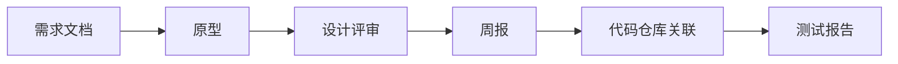

# 需求规格说明书（SRS）

| 项目 | 内容 |
|---|---|
| 项目名称 | 毕业论文（设计）过程管理平台 |
| 课程 | 软件工程专业实践课程 |
| 文档版本 | v0.1（第 1 周设计基线） |
| 编写日期 | 2026-10-19 |
| 开发方式 | 1 人开发，6 周，每周 5–6 学时 |
| 状态 | 范围已冻结，进入迭代实现 |

---

## 1. 引言

### 1.1 背景

毕业设计管理通常依赖微信群、邮件、共享网盘和线下表格，存在材料版本混乱、评审意见难追溯、导师重复催收、进度不透明等问题。本平台把“学生提交材料—导师审核反馈—过程进度可视化”收敛到一个系统中。

### 1.2 目标

在 33 学时有效开发时间内，交付一个可运行、可演示的最小可行系统，覆盖：

**需求文档 → 原型 → 设计评审 → 周报 → 代码仓库关联 → 测试报告**

### 1.3 范围

本期只实现学生和导师两个角色的核心流程。管理员功能不开发，仅通过种子 SQL 初始化数据。

### 1.4 术语

| 术语 | 含义 |
|---|---|
| 材料 | 需求文档、原型、测试报告等可提交对象 |
| 设计评审 | 导师对需求与原型给出的评分、评语和通过/退回结论 |
| 退回 | 审核不通过，学生可修改后重新提交 |
| 六步进度 | 由材料、评审、周报、仓库数据实时计算的阶段状态 |
| 种子数据 | 系统初始化时写入的演示账号与项目数据 |

---

## 2. 用户角色

| 角色 | 职责 | 权限边界 |
|---|---|---|
| 学生 | 提交需求文档、原型、测试报告；查看反馈并重交；提交周报；绑定代码仓库 | 只能访问自己的项目及数据 |
| 导师 | 查看名下学生；审核材料；执行设计评审；批阅周报；审核测试报告 | 只能访问自己名下的学生 |
| 管理员（不开发界面） | 通过种子 SQL 初始化账号与项目关系 | 无运行时管理界面 |

---

## 3. 业务流程

### 3.1 主流程

补充规则：

- 需求文档与原型都通过后，才能提交设计评审；
- 周报是贯穿开发过程的周期性活动，不是一次性关卡；
- 代码仓库关联与周报并行，测试报告在收尾阶段提交；
- 测试报告通过后视为六步流程完成。

### 3.2 状态规则

| 对象 | 状态 | 规则 |
|---|---|---|
| 材料 | `SUBMITTED` / `APPROVED` / `RETURNED` | 每次重交新增一条记录，旧记录只读 |
| 设计评审 | `PASS` / `RETURN` | 记录评分、评语、评审轮次；退回后可再次评审 |
| 周报 | `SUBMITTED` / `REVIEWED` / `RETURNED` | 导师批阅后写入评语 |
| 代码仓库 | `NOT_SYNCED` / `SUCCESS` / `FAILED` | 同步失败允许手工填写 commit 数 |

### 3.3 阶段完成判定

| 步骤 | 完成条件 |
|---|---|
| 1 需求文档 | 最新需求材料状态为 `APPROVED` |
| 2 原型 | 最新原型材料状态为 `APPROVED` |
| 3 设计评审 | 最近一次设计评审结果为 `PASS` |
| 4 周报 | 至少 1 篇周报被导师批阅；其余周报继续累计 |
| 5 代码仓库 | 仓库绑定成功且最近一次同步成功 |
| 6 测试报告 | 最新测试报告状态为 `APPROVED` |

---

## 4. 功能需求

| 编号 | 功能 | 说明 | 优先级 | 计划周 | 验收标准 |
|---|---|---|---|---|---|
| FR-01 | 登录与角色隔离 | 用户名 + 密码 + JWT；角色 `STUDENT/ADVISOR` | P0 | W2 | 正确登录；错误密码有提示；学生访问导师接口返回 403 |
| FR-02 | 学生工作台 | 六步进度条；材料、评审、周报、仓库、测试报告 Tab | P0 | W2 | 只显示当前学生自己的数据；阶段状态随数据变化 |
| FR-03 | 导师学生列表 | 名下学生、课题、当前阶段、待处理数量 | P0 | W2 | 导师只看到自己名下学生 |
| FR-04 | 材料提交 | 上传 PDF/DOCX/ZIP/图片或填写外链；类型为需求/原型/测试报告 | P0 | W3 | 文件可下载；非法类型/超大文件被拒绝 |
| FR-05 | 材料审核 | 导师通过/退回并填写评语；学生可重交 | P0 | W3 | 退回后学生看到原因并可重新提交，历史保留 |
| FR-06 | 设计评审 | 导师评分（0–100）+ 评语 + 通过/退回 | P0 | W3 | 需求或原型未通过时不能通过评审；记录轮次 |
| FR-07 | 周报 | 学生按周提交本周进展、问题、下周计划；导师批阅 | P0 | W3–W4 | 可提交、批阅；导师可查看历史周报 |
| FR-08 | 代码仓库关联 | 绑定公开 GitHub/Gitee 仓库；手动同步 commit 统计；失败可手工填写 | P0 | W4 | 同步成功显示 commit 数与最近提交；错误 URL 有提示 |
| FR-09 | 测试报告 | 用例数、通过率、缺陷数、附件；导师通过/退回 | P0 | W4 | 数值校验正确；附件可下载；审核状态更新 |
| FR-10 | 六步进度计算 | 根据材料/评审/周报/仓库/测试报告实时计算 | P0 | W2–W4 | 与导师列表和审核结果一致 |
| FR-11 | 种子数据 | 2 名学生、1 名导师、2 个项目 | P0 | W1 | 启动后可直接演示，无需手工建数据 |

### 4.1 关键业务约束

1. 学生只能操作自己的项目；导师只能操作名下学生。
2. 设计评审必须建立在需求文档和原型均通过的基础上。
3. 材料每次提交生成新记录，不覆盖历史版本。
4. 仓库只支持公开地址；不存储 GitHub/Gitee Token。
5. 周报同一周允许重新提交，以最新记录为准。
6. 测试报告通过后，六步流程完成，不再允许修改。

---

## 5. 非功能需求

| 编号 | 类别 | 要求 |
|---|---|---|
| NFR-01 | 安全 | 密码 BCrypt 存储；接口校验登录与角色；文件上传白名单 + 20MB 限制；下载鉴权；防 SQL 注入 |
| NFR-02 | 易用性 | 使用 Element Plus 标准组件；主要操作不超过 3 次点击；错误提示明确 |
| NFR-03 | 兼容性 | Chrome / Edge 最新版；1366×768 及以上分辨率 |
| NFR-04 | 性能 | 演示环境下关键接口响应 < 1 秒；不做压力测试 |
| NFR-05 | 部署 | 本地一条命令启动；不依赖 Docker；开发用 H2，生产可切换 MySQL |
| NFR-06 | 可维护性 | 统一响应结构与异常处理；6 张表；接口文档化；代码结构清晰 |

---

## 6. 数据需求

| 表 | 用途 | 关键字段 |
|---|---|---|
| `sys_user` | 用户与角色 | username、password_hash、real_name、role |
| `project` | 学生与导师的课题关系 | title、student_id、advisor_id |
| `artifact` | 材料与审核状态 | project_id、type、file_path、external_url、status、score、feedback |
| `design_review` | 设计评审记录 | project_id、reviewer_id、score、comment、result、round_no |
| `weekly_report` | 周报与批阅 | project_id、week_no、content、status、comment |
| `repo_binding` | 仓库绑定与同步结果 | project_id、repo_url、commit_count、last_sync_at、sync_status |

详细字段、类型和外键见《02-概要设计》。

---

## 7. 页面清单

| 页面 | 角色 | 核心内容 |
|---|---|---|
| 登录页 | 公共 | 账号密码、演示账号、后端连接状态 |
| 学生工作台 | 学生 | 六步进度、材料提交、设计评审、周报、仓库、测试报告 |
| 导师学生列表 | 导师 | 名下学生、当前阶段、待处理数量 |
| 导师学生详情 | 导师 | 材料审核、设计评审、周报批阅、测试报告审核 |

低保真原型共 8 个画面，见 `prototype/index.html`。

---

## 8. 约束与不做范围

### 8.1 约束

- 1 人开发，每周 5–6 学时，6 周共 33 学时计划交付 + 3 学时机动；
- 本机无 MySQL、无 Docker，开发阶段使用 H2（MySQL 兼容模式）；
- 不引入新框架，优先使用现成模板和 Element Plus 组件。

### 8.2 明确不做

课题双选、阶段模板、动态 RBAC、用户管理界面、站内通知、图表预警、评审专家分配、多轮复杂评审、文件版本号/对比、OAuth、Token 加密、Webhook、定时自动同步、Word/PDF 导出、移动端、E2E 自动化、性能测试。

---

## 9. 验收标准

1. 学生/导师账号可登录，角色与数据隔离正确。
2. 同一学生可完成“需求 → 原型 → 设计评审 → 周报 → 仓库 → 测试报告”全流程。
3. 退回、重交、通过状态正确，历史记录可追溯。
4. 六步进度与导师列表中的状态一致。
5. 仓库同步失败时可用手工方式完成演示。
6. 第 3 周末完成计划交付量的 53%，满足中期进度要求。
7. 项目可在本地启动，有种子数据、README、测试报告和课程报告。

---

## 10. 需求追踪矩阵

| 需求 | 页面 | 接口 | 数据表 | 验收 |
|---|---|---|---|---|
| FR-01 | 登录页 | `/api/auth/login`、`/api/auth/me` | sys_user | 角色隔离 |
| FR-02 | 学生工作台 | `/api/student/project` | project、artifact、design_review、weekly_report、repo_binding | 六步状态正确 |
| FR-03 | 导师学生列表 | `/api/advisor/students` | project、sys_user | 只看到名下学生 |
| FR-04 | 材料 Tab | `/api/student/artifacts` | artifact | 上传/外链/历史 |
| FR-05 | 导师详情 | `/api/advisor/artifacts/{id}/review` | artifact | 通过/退回/重交 |
| FR-06 | 设计评审 Tab | `/api/advisor/projects/{id}/design-review` | design_review | 评分/评语/轮次 |
| FR-07 | 周报 Tab | `/api/student/weekly-reports`、`/api/advisor/weekly-reports/{id}/review` | weekly_report | 提交/批阅 |
| FR-08 | 仓库 Tab | `/api/student/repo-binding`、`/sync` | repo_binding | 同步/兜底 |
| FR-09 | 测试报告 Tab | `/api/student/artifacts`、`/api/advisor/artifacts/{id}/review` | artifact | 审核通过 |
| FR-10 | 学生/导师页面 | 各查询接口 | 全部 | 状态一致 |
| FR-11 | 启动数据 | 无 | sys_user、project | 演示账号可用 |

---

## 11. 变更记录

| 日期 | 版本 | 变更 |
|---|---|---|
| 2026-10-19 | v0.1 | 第 1 周需求基线：六步主线、2 个角色、6 张表、16 个接口；范围冻结 |
