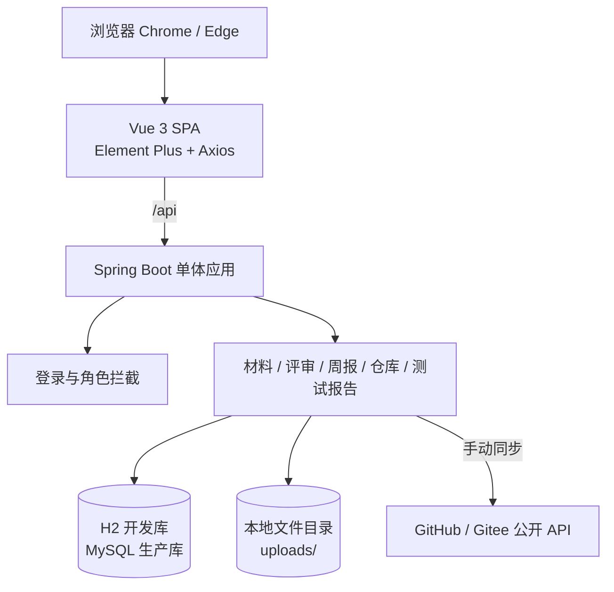
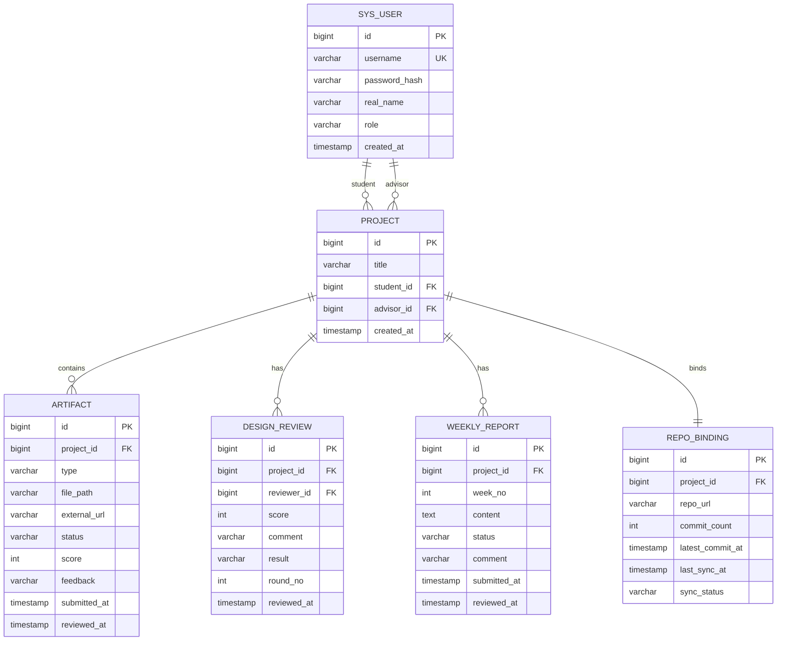

# 概要设计说明书

| 项目 | 内容 |
|---|---|
| 项目名称 | 毕业论文（设计）过程管理平台 |
| 文档版本 | v0.2（第 2 周） |
| 编写日期 | 2026-10-24 |
| 对应需求 | `docs/01-需求规格说明书.md` v0.1 |
| 对应实现 | 第 2 周 M1（JWT 登录、角色隔离、学生/导师真实工作台） |

---

## 1. 设计目标与约束

- **目标**：用最小实现打通六步主线，保证第 3 周末可演示核心闭环；
- **规模**：2 个角色、4 个主页面、6 张表、约 16 个接口；
- **约束**：单人开发、33 学时计划交付、本机无 MySQL/Docker；
- **原则**：单体优先、固定流程优先、复用组件优先，不做通用工作流引擎。

---

## 2. 系统架构



- 前后端分离，前端开发服务器将 `/api` 代理到后端 8080；
- 后端按 Controller → Service → Mapper 分层；第 2 周已实现认证、学生/导师查询与六步进度计算；
- 文件存储使用本地目录，下载接口鉴权；
- 仓库同步采用“手动触发 + 公开 API”，失败时手工兜底。

---

## 3. 技术选型

| 层次 | 选型 | 说明 |
|---|---|---|
| 前端 | Vue 3.5 + Vite 6 + Element Plus 2.9 + Axios | 组件化、开发效率高 |
| 后端 | Java 21 + Spring Boot 3.3.5 | 课程主流技术栈 |
| 持久层 | MyBatis-Plus 3.5.9 | 简化单表 CRUD |
| 开发数据库 | H2（MySQL 兼容模式，文件持久化） | 本机无 MySQL；降低启动成本 |
| 生产数据库 | MySQL 8.0 | 提供 `db/schema-mysql.sql` 与 `db/data-mysql.sql` |
| 认证 | JWT + 登录拦截器 | 第 2 周已实现（HS256、8 小时），不引入完整 Spring Security |
| 文件存储 | 本地 `uploads/` | 白名单 + 20MB + 随机文件名 |
| 测试 | JUnit 5 + MockMvc + Postman/Apifox | 轻量自动化 + 手工验收 |
| 部署 | 本地启动脚本 | 不使用 Docker；可选后续补充 |

### 3.1 环境说明

当前开发机已安装 Node 24.21、Java 21.0.5、Maven 3.9.15，未安装 MySQL 和 Docker。因此：

- 第 1–2 周使用 H2 文件数据库启动后端；
- MySQL 建表与种子脚本已单独提供，部署时切换 `application.yml` 的 JDBC URL 即可；
- H2 控制台仅用于开发，生产环境应关闭。

---

## 4. 数据库设计

### 4.1 ER 图



### 4.2 表结构

#### sys_user

| 字段 | 类型 | 约束 | 说明 |
|---|---|---|---|
| id | BIGINT | PK, AUTO_INCREMENT | 主键 |
| username | VARCHAR(50) | NOT NULL, UNIQUE | 学号/工号 |
| password_hash | VARCHAR(100) | NOT NULL | BCrypt 哈希 |
| real_name | VARCHAR(50) | NOT NULL | 姓名 |
| role | VARCHAR(20) | NOT NULL | `STUDENT` / `ADVISOR` |
| created_at | TIMESTAMP | DEFAULT CURRENT_TIMESTAMP | 创建时间 |

#### project

| 字段 | 类型 | 约束 | 说明 |
|---|---|---|---|
| id | BIGINT | PK, AUTO_INCREMENT | 主键 |
| title | VARCHAR(200) | NOT NULL | 课题名称 |
| student_id | BIGINT | FK → sys_user.id | 学生 |
| advisor_id | BIGINT | FK → sys_user.id | 导师 |
| created_at | TIMESTAMP | DEFAULT CURRENT_TIMESTAMP | 创建时间 |

#### artifact

| 字段 | 类型 | 约束 | 说明 |
|---|---|---|---|
| id | BIGINT | PK, AUTO_INCREMENT | 主键 |
| project_id | BIGINT | FK → project.id | 所属项目 |
| type | VARCHAR(30) | NOT NULL | `REQUIREMENT` / `PROTOTYPE` / `TEST_REPORT` |
| file_path | VARCHAR(255) | NULL | 本地文件路径 |
| external_url | VARCHAR(500) | NULL | 外部链接 |
| status | VARCHAR(20) | NOT NULL | `SUBMITTED` / `APPROVED` / `RETURNED` |
| score | INT | NULL | 审核分数（可选） |
| feedback | VARCHAR(1000) | NULL | 导师评语 |
| submitted_at | TIMESTAMP | DEFAULT CURRENT_TIMESTAMP | 提交时间 |
| reviewed_at | TIMESTAMP | NULL | 审核时间 |

> 每次重新提交插入新记录，不覆盖旧记录，历史通过 `submitted_at` 排序展示。

#### design_review

| 字段 | 类型 | 约束 | 说明 |
|---|---|---|---|
| id | BIGINT | PK, AUTO_INCREMENT | 主键 |
| project_id | BIGINT | FK → project.id | 所属项目 |
| reviewer_id | BIGINT | FK → sys_user.id | 评审导师 |
| score | INT | NOT NULL | 0–100 |
| comment | VARCHAR(1000) | NULL | 评审意见 |
| result | VARCHAR(20) | NOT NULL | `PASS` / `RETURN` |
| round_no | INT | NOT NULL, DEFAULT 1 | 评审轮次 |
| reviewed_at | TIMESTAMP | DEFAULT CURRENT_TIMESTAMP | 评审时间 |

#### weekly_report

| 字段 | 类型 | 约束 | 说明 |
|---|---|---|---|
| id | BIGINT | PK, AUTO_INCREMENT | 主键 |
| project_id | BIGINT | FK → project.id | 所属项目 |
| week_no | INT | NOT NULL | 周次 |
| content | TEXT | NOT NULL | 本周进展/问题/下周计划 |
| status | VARCHAR(20) | NOT NULL | `SUBMITTED` / `REVIEWED` / `RETURNED` |
| comment | VARCHAR(1000) | NULL | 导师评语 |
| submitted_at | TIMESTAMP | DEFAULT CURRENT_TIMESTAMP | 提交时间 |
| reviewed_at | TIMESTAMP | NULL | 批阅时间 |

#### repo_binding

| 字段 | 类型 | 约束 | 说明 |
|---|---|---|---|
| id | BIGINT | PK, AUTO_INCREMENT | 主键 |
| project_id | BIGINT | NOT NULL, UNIQUE | 一个项目一个仓库 |
| repo_url | VARCHAR(500) | NOT NULL | 公开仓库地址 |
| commit_count | INT | NOT NULL, DEFAULT 0 | 提交总数 |
| latest_commit_at | TIMESTAMP | NULL | 最近提交时间 |
| last_sync_at | TIMESTAMP | NULL | 最近同步时间 |
| sync_status | VARCHAR(20) | NOT NULL | `NOT_SYNCED` / `SUCCESS` / `FAILED` |

---

## 5. 接口设计

### 5.1 统一响应

```json
{
  "code": 0,
  "message": "ok",
  "data": {}
}
```

| code | 含义 |
|---|---|
| 0 | 成功 |
| 400 | 参数错误 |
| 401 | 未登录 |
| 403 | 无权限 |
| 404 | 资源不存在 |
| 500 | 服务器内部错误 |

### 5.2 接口清单

| 方法 | 路径 | 说明 | 状态 |
|---|---|---|---|
| GET | `/api/health` | 健康检查（Web + DB） | **W1 已实现** |
| POST | `/api/auth/login` | 登录并返回 JWT | **W2 已实现** |
| GET | `/api/auth/me` | 当前登录用户 | **W2 已实现** |
| GET | `/api/student/project` | 学生项目与六步数据 | **W2 已实现**（前 3 步真实；W3–W5 扩展） |
| POST | `/api/student/artifacts` | 上传材料/外链 | W3 |
| GET | `/api/files/{id}` | 鉴权下载 | W3 |
| POST | `/api/student/weekly-reports` | 提交周报 | W4 |
| GET | `/api/student/weekly-reports` | 我的周报 | W4 |
| POST | `/api/student/repo-binding` | 绑定仓库 | W4 |
| POST | `/api/student/repo-binding/sync` | 手动同步 | W4 |
| POST | `/api/student/repo-binding/manual-count` | 手工填写 commit 数 | W4 |
| GET | `/api/advisor/students` | 名下学生列表 | **W2 已实现** |
| GET | `/api/advisor/students/{projectId}` | 学生详情 | **W2 已实现**（六步详情；W3–W4 扩展） |
| POST | `/api/advisor/artifacts/{id}/review` | 材料审核 | W3 |
| POST | `/api/advisor/projects/{id}/design-review` | 设计评审 | W3 |
| POST | `/api/advisor/weekly-reports/{id}/review` | 批阅周报 | W4 |
| GET | `/api/advisor/weekly-reports?projectId=` | 学生周报 | W4 |

### 5.3 已实现接口示例（W1–W2）

#### 5.3.1 健康检查

`GET /api/health`

```json
{
  "code": 0,
  "message": "ok",
  "data": {
    "status": "UP",
    "database": "UP",
    "userCount": 3,
    "phase": "week-2-auth",
    "timestamp": "2026-10-24T20:30:00+08:00"
  }
}
```

#### 5.3.2 登录

```http
POST /api/auth/login
Content-Type: application/json

{ "username": "stu001", "password": "123456" }
```

```json
{
  "code": 0,
  "message": "ok",
  "data": {
    "token": "<jwt>",
    "expiresInSeconds": 28800,
    "user": { "id": 1, "username": "stu001", "realName": "张同学", "role": "STUDENT" }
  }
}
```

失败约定：

| 场景 | HTTP | message |
|---|---:|---|
| 用户不存在或密码错误 | 401 | 用户名或密码错误 |
| 角色不是学生/导师 | 401 | 用户名或密码错误 |
| 用户名为空、密码长度不合法 | 400 | 字段校验消息 |

#### 5.3.3 当前用户

`GET /api/auth/me`，需要 `Authorization: Bearer <token>`，返回与登录响应中的 `user` 相同结构。

#### 5.3.4 学生项目与六步进度

`GET /api/student/project`

```json
{
  "code": 0,
  "message": "ok",
  "data": {
    "projectId": 1,
    "title": "基于 Spring Boot 的图书管理系统",
    "student": { "id": 1, "username": "stu001", "realName": "张同学", "role": "STUDENT" },
    "advisor": { "id": 3, "username": "tea001", "realName": "王老师", "role": "ADVISOR" },
    "completedStepCount": 0,
    "currentStep": 1,
    "allCompleted": false,
    "steps": [
      { "key": "REQUIREMENT", "title": "需求文档", "status": "NOT_STARTED", "description": "待提交（第 3 周开放）" },
      { "key": "PROTOTYPE", "title": "原型", "status": "NOT_STARTED", "description": "待提交（第 3 周开放）" },
      { "key": "DESIGN_REVIEW", "title": "设计评审", "status": "NOT_STARTED", "description": "需求与原型通过后可评审" },
      { "key": "WEEKLY_REPORT", "title": "周报", "status": "NOT_STARTED", "description": "第 4 周开放提交与批阅" },
      { "key": "REPO_BINDING", "title": "代码仓库", "status": "NOT_STARTED", "description": "第 4 周开放仓库绑定" },
      { "key": "TEST_REPORT", "title": "测试报告", "status": "NOT_STARTED", "description": "第 4–5 周开放" }
    ]
  }
}
```

步骤状态取值：`COMPLETED`、`IN_REVIEW`、`RETURNED`、`NOT_STARTED`。

#### 5.3.5 导师名下学生

`GET /api/advisor/students`

```json
{
  "code": 0,
  "message": "ok",
  "data": {
    "studentCount": 2,
    "pendingArtifactCount": 0,
    "pendingWeeklyReportCount": 0,
    "students": [
      {
        "projectId": 1,
        "studentId": 1,
        "studentName": "张同学",
        "username": "stu001",
        "title": "基于 Spring Boot 的图书管理系统",
        "completedStepCount": 0,
        "currentStep": 1,
        "currentStage": "需求文档",
        "currentStepStatus": "NOT_STARTED",
        "pendingCount": 0
      }
    ]
  }
}
```

`GET /api/advisor/students/{projectId}` 返回与 5.3.4 相同的学生项目结构；课题不属于当前导师时返回 403，课题不存在时返回 404。

### 5.4 后续接口约定（第 3–4 周）

**材料提交**

```http
POST /api/student/artifacts
Content-Type: multipart/form-data

type=REQUIREMENT
file=<binary>
externalUrl=<optional>
```

**设计评审**

```http
POST /api/advisor/projects/1/design-review
Content-Type: application/json

{ "score": 86, "comment": "需求边界清楚，建议补充异常场景。", "result": "PASS" }
```

### 5.5 认证与访问控制（W2 已实现）

**Token 约定**

| 项目 | 设计 |
|---|---|
| 位置 | `Authorization: Bearer <token>` |
| 算法 | HS256，密钥至少 32 字节 |
| 有效期 | 8 小时（28800 秒），无刷新 Token |
| 声明 | `sub`（用户 id）、`username`、`realName`、`role` |
| 密钥配置 | `app.jwt.secret`，支持 `JWT_SECRET` 环境变量覆盖 |

**拦截器规则**

- 拦截 `/api/**`；
- 放行 `OPTIONS`、`/api/auth/login`、`/api/health`；
- 缺失或非法 Token → 401；
- `/api/student/**` 非 `STUDENT` → 403；
- `/api/advisor/**` 非 `ADVISOR` → 403。

**数据归属**

- 学生接口只用 Token 中的用户 id 查询本人课题，不接受前端传入的身份参数；
- 导师列表固定按 `advisor_id = 当前用户` 过滤；
- 导师查看详情时再次校验 `project.advisor_id`，不匹配返回 403。

**前端处理**

- Token 与用户信息保存到 `localStorage`；
- Axios 自动附加鉴权头；
- 401 时清除会话并跳转登录页；
- 路由守卫按 `requiresAuth`、`role`、`guestOnly` 控制访问。

---

## 6. 核心状态与规则

### 6.1 材料状态

```text
SUBMITTED ──导师通过──> APPROVED
    └──────导师退回──> RETURNED ──学生重交──> SUBMITTED（新记录）
```

- 需求文档与原型都必须是 `APPROVED`，才允许设计评审通过；
- 测试报告通过后六步流程完成。

### 6.2 六步进度计算

| 步骤 | 计算方式 |
|---|---|
| 需求文档 | 最新 `REQUIREMENT` 记录为 `APPROVED` |
| 原型 | 最新 `PROTOTYPE` 记录为 `APPROVED` |
| 设计评审 | 最新 `design_review.result = PASS` |
| 周报 | 统计已批阅篇数；至少 1 篇即显示“已开始” |
| 代码仓库 | `repo_binding.sync_status = SUCCESS` |
| 测试报告 | 最新 `TEST_REPORT` 记录为 `APPROVED` |

### 6.3 权限规则

- 登录成功后 JWT 的 `sub` 携带用户 id，`role` 携带角色；
- `/api/student/**` 仅允许 `STUDENT`，`/api/advisor/**` 仅允许 `ADVISOR`，路径与角色不匹配返回 403；
- 学生接口只使用 Token 中的用户 id，查询条件固定为 `project.student_id = 当前用户`；
- 导师接口固定使用 `project.advisor_id = 当前导师`，详情接口再次校验归属；
- 文件下载必须校验文件所属项目；
- 未登录、Token 非法或过期返回 401；角色不符或数据不属于当前用户返回 403；
- 前端收到 401 清除会话，收到 403 只提示无权限。

### 6.4 仓库同步规则

1. 只接受 `https://github.com/{owner}/{repo}` 或 `https://gitee.com/{owner}/{repo}` 形式的公开地址；
2. 同步时调用公开 API 获取 commit 数、最近提交时间与最近提交列表；
3. 同步失败保留上次成功结果，状态置为 `FAILED`；
4. 提供手工填写 commit 数的兜底接口，保证演示不依赖网络；
5. 不存储用户 Token，不做定时同步。

---

## 7. 工程结构

```text
毕业论文管理系统/
├─ backend/                    Spring Boot 后端
│  ├─ pom.xml                  JJWT 0.12.6 等依赖
│  └─ src/
│     ├─ main/java/com/example/thesis/
│     │  ├─ auth/              JwtService、AuthInterceptor、AuthContext
│     │  ├─ common/            ApiResponse、ApiException、全局异常处理
│     │  ├─ config/            CORS、拦截器注册、BCrypt Bean
│     │  ├─ controller/        Auth、Health、Student、Advisor
│     │  ├─ dto/               登录、用户视图、六步状态、学生/导师响应
│     │  ├─ entity/            User、Project、Artifact、DesignReview
│     │  ├─ mapper/            MyBatis-Plus Mapper
│     │  └─ service/           AuthService、ProjectProgressService
│     ├─ main/resources/
│     │  ├─ application.yml
│     │  ├─ schema.sql         H2 开发建表
│     │  └─ data.sql           种子数据
│     └─ test/                 健康检查、登录、越权与数据隔离测试
├─ frontend/                   Vue 3 前端
│  └─ src/
│     ├─ api/http.js           Axios 封装与 JWT 请求头
│     ├─ auth/session.js       Token / 用户本地存储
│     ├─ router/index.js       角色路由守卫
│     ├─ utils/status.js       六步状态展示映射
│     └─ views/                登录、学生工作台、导师工作台
├─ prototype/                  8 个低保真页面
├─ docs/                       SRS、概要设计、实验报告、截图
├─ db/                         MySQL 建表与种子脚本
├─ uploads/                    文件上传目录（第 3 周使用）
├─ plan.md                     6 周开发计划
└─ 开发进度.md                 实验进度记录
```

---

## 8. 第 1–2 周已实现范围

| 项目 | 状态 |
|---|---|
| 需求规格说明书 v0.1 | 已完成（W1） |
| 概要设计（ER、表结构、接口、状态规则） | 已完成（W1，W2 更新至 v0.2） |
| 低保真原型 8 页 | 已完成（W1） |
| Spring Boot 脚手架 | 已完成（W1） |
| H2 数据库、6 张表、种子数据 | 已完成（W1） |
| `/api/health` 健康检查 | 已完成（W1） |
| Vue 3 + Element Plus 脚手架 | 已完成（W1） |
| JWT 登录、BCrypt 校验、角色拦截 | 已完成（W2） |
| `/api/auth/login`、`/api/auth/me` | 已完成（W2） |
| `/api/student/project` | 已完成（W2，前 3 步真实计算） |
| `/api/advisor/students`、`/api/advisor/students/{projectId}` | 已完成（W2） |
| 学生工作台、导师列表与详情抽屉 | 已完成（W2） |
| 前端 Token、鉴权头、路由守卫、401 自动回登录 | 已完成（W2） |
| 登录/越权/数据隔离测试 | 已完成（W2，共 11 个） |
| 材料上传与审核 | 第 3 周 |
| 设计评审 | 第 3 周 |
| 周报、仓库、测试报告 | 第 4–5 周 |

---

## 9. 关键设计取舍

| 决策 | 选择 | 理由 |
|---|---|---|
| 架构 | 单体应用 | 6 周、1 人开发，微服务增加无意义的部署与联调成本 |
| 开发数据库 | H2 文件库 | 本机无 MySQL；H2 与 MySQL 兼容模式便于切换 |
| 流程配置 | 固定六步 | 阶段模板引擎会让“配置系统”占用核心开发时间 |
| 材料历史 | 每次提交新增记录 | 避免版本号、文件覆盖和复杂回滚逻辑 |
| 仓库集成 | 公开 API + 手动同步 | 本地开发没有公网 Webhook；OAuth/Token 管理超出范围 |
| 认证 | JJWT + 自定义拦截器 | 只有两种固定角色，完整 Spring Security 配置成本高且演示不直观 |
| 角色权限 | 固定角色 + 数据归属校验 | 不做动态 RBAC 和菜单配置 |
| 文件存储 | 本地目录 | 课程项目无需对象存储；重点是白名单与鉴权 |
| 统计展示 | 简单卡片/进度条 | 不做图表库与风险规则，节省时间 |

---

## 10. 变更记录

| 日期 | 版本 | 变更 |
|---|---|---|
| 2026-10-19 | v0.1 | 第 1 周设计基线：架构、6 张表、16 个接口、六步状态规则 |
| 2026-10-24 | v0.2 | 第 2 周实现同步：JWT/BCrypt/拦截器设计、5 个接口标记完成、401/403 规则、六步进度计算与数据隔离 |
