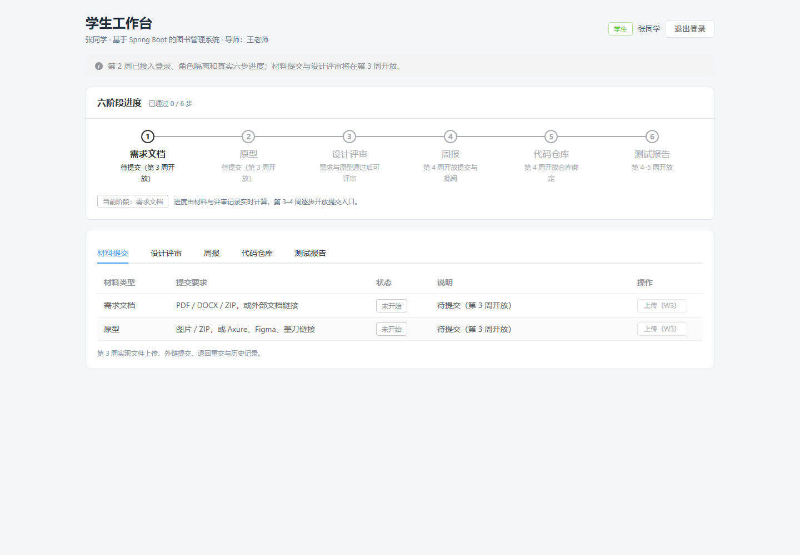
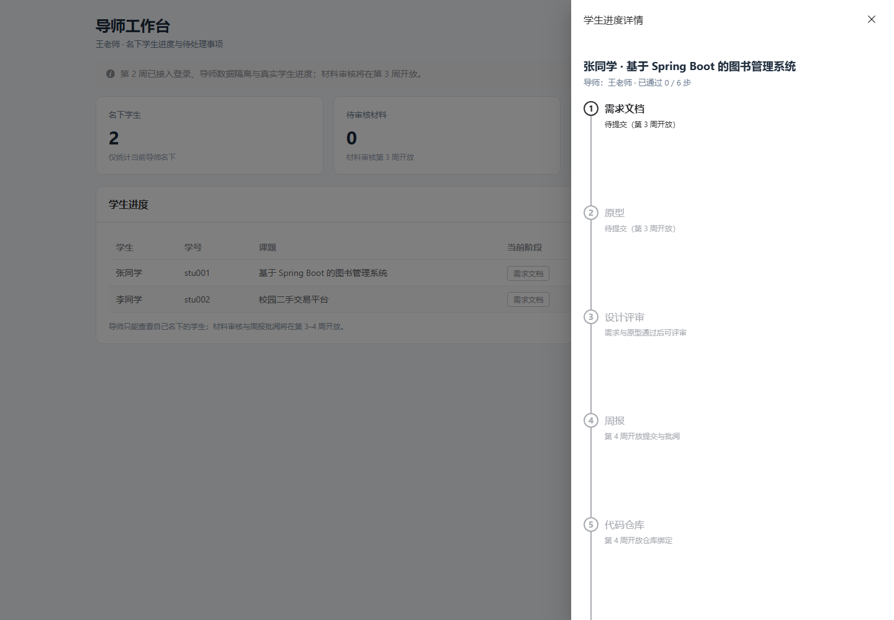

# 实验报告 2

| 项目 | 内容 |
|---|---|
| 课程名称 | 软件工程专业实践课程 |
| 实验名称 | 毕业设计过程管理平台——JWT 登录、角色隔离与真实工作台 |
| 实验周次 | 第 2 周（实际完成日期 2026-10-24） |
| 实验学时 | 5.5 学时 |
| 姓名 | ＿＿＿＿＿＿ |
| 学号 | ＿＿＿＿＿＿ |
| 班级 | ＿＿＿＿＿＿ |
| 实验日期 | 2026 年 10 月 24 日 |

---

## 一、实验目的

1. 在 Spring Boot 中实现基于 JWT 的无状态登录，使用 BCrypt 校验密码，掌握登录拦截器与统一异常响应的实现方式。
2. 按“角色 + 路径 + 数据归属”三层规则实现权限隔离，验证学生与导师之间的横向越权被阻止。
3. 将学生项目、导师名下学生及六步进度从静态占位改为数据库实时计算，打通前后端真实数据链路。
4. 在前端实现 Token 持久化、Axios 鉴权头、路由守卫和 401 自动回登录，保证刷新页面与会话失效场景可用。
5. 通过自动化测试与端到端联调验证 M1（登录与基础页面）里程碑。

---

## 二、实验环境

| 类别 | 环境 / 版本 |
|---|---|
| 操作系统 | Windows 11 Home China（10.0.26200） |
| JDK | Java 21.0.5 |
| 构建工具 | Maven 3.9.15、npm 11.19 |
| 后端框架 | Spring Boot 3.3.5、MyBatis-Plus 3.5.9 |
| 认证组件 | JJWT 0.12.6（HS256）、Spring Security Crypto（BCrypt） |
| 开发数据库 | H2（MySQL 兼容模式、文件持久化） |
| 前端框架 | Vue 3.5、Vite 6.4.4、Element Plus 2.9、Axios、Vue Router |
| 测试工具 | JUnit 5、MockMvc、Node 脚本、无头 Chrome |
| 启动方式 | `mvn package` + `java -jar`（规避中文路径下 `spring-boot:run` 的问题） |

---

## 三、实验内容与过程

### 3.1 认证方案设计

系统只有 `STUDENT` 和 `ADVISOR` 两种角色，课程范围内不需要完整的 Spring Security 授权模型，因此采用“JJWT + 自定义拦截器”的轻量方案：

- 登录成功后签发 JWT，前端放入 `Authorization: Bearer <token>`；
- 后端拦截器统一验签，解析出用户身份后写入请求上下文；
- 不在服务端保存会话，不做刷新 Token、Token 黑名单和验证码。

选择该方案的原因：

1. 与前后端分离结构匹配，刷新页面后仍可恢复登录状态；
2. 比引入完整 Spring Security 配置更易理解和演示；
3. 认证逻辑集中在一个拦截器中，后续扩展接口时不需要重复写权限判断。

### 3.2 登录与 JWT 实现

**密码校验**

- 种子账号的密码使用 BCrypt 哈希存储在 `sys_user.password_hash`；
- `AuthService` 按用户名查询用户，调用 `PasswordEncoder.matches` 校验；
- 用户不存在与密码错误统一返回 `401`，消息固定为“用户名或密码错误”，避免通过错误信息枚举账号；
- 登录只接受 `STUDENT` / `ADVISOR` 两种角色，其他角色一律拒绝。

**Token 签发**

- 使用 HS256 签名，密钥长度不少于 32 字节；
- 有效期 8 小时（28800 秒），响应中同时返回 `expiresInSeconds`；
- 载荷包含 `sub`（用户 id）、`username`、`realName`、`role`；
- 密钥支持通过环境变量 `JWT_SECRET` 覆盖，开发环境提供默认值；
- 不在 Token 中存放密码哈希等敏感信息。

**当前用户获取**

`GET /api/auth/me` 不直接信任 Token 中的展示字段，而是从 `sub` 取出用户 id 后回查数据库，再返回 `UserView`，避免用户改名或角色调整后仍返回过期信息。

### 3.3 登录拦截器与角色隔离

`AuthInterceptor` 注册在 `/api/**` 上，处理流程如下：

1. 放行 `OPTIONS` 预检请求，避免 CORS 预检被误判为未登录；
2. 放行公开路径 `/api/auth/login`、`/api/health`；
3. 缺少 `Authorization` 头或格式不是 `Bearer <token>` 时返回 401；
4. 验签失败、Token 过期或载荷不合法时返回 401；
5. 解析成功后写入 `AuthContext`，供 Controller / Service 读取；
6. 按路径前缀校验角色：

| 路径前缀 | 允许角色 | 不匹配时 |
|---|---|---|
| `/api/student/**` | `STUDENT` | 403，提示“当前账号无权访问学生接口” |
| `/api/advisor/**` | `ADVISOR` | 403，提示“当前账号无权访问导师接口” |
| `/api/auth/**`（登录除外） | 已登录用户 | 401 |

401 与 403 的区分：

- **401**：没有身份或身份失效，应重新登录；
- **403**：身份有效但角色不允许，重新登录也不能解决。

所有错误响应保持统一结构 `{ code, message, data }`，HTTP 状态码与 `code` 一致。

### 3.4 业务接口与数据隔离

第 2 周实现 5 个接口：

| 方法 | 路径 | 说明 |
|---|---|---|
| POST | `/api/auth/login` | 登录，返回 Token、过期时间与用户信息 |
| GET | `/api/auth/me` | 当前登录用户 |
| GET | `/api/student/project` | 学生本人课题、导师、六步进度 |
| GET | `/api/advisor/students` | 导师名下学生列表与待处理统计 |
| GET | `/api/advisor/students/{projectId}` | 导师查看名下学生进度详情 |

**学生端数据隔离**

- 学生 id 只从已验签的 Token 中读取，不接受前端传入的 `studentId`；
- Service 以 `student_id = 当前用户` 查询课题，取第一项返回；
- 如果账号没有关联课题，返回 404“未找到与当前账号关联的课题”。

**导师端数据隔离**

- 列表查询固定使用 `advisor_id = 当前用户`，不会返回其他导师的学生；
- 详情接口先按 `projectId` 查询课题，再校验 `project.advisor_id` 是否等于当前导师 id；
- 不匹配时返回 403，而不是 404，便于演示“越权被识别并拒绝”；
- 测试中额外插入“赵老师”和他的课题，验证王老师无法查看。

### 3.5 六步进度计算

六步流程为：

```text
需求文档 → 原型 → 设计评审 → 周报 → 代码仓库 → 测试报告
```

第 2 周不实现材料提交，但需要让工作台展示真实计算逻辑，因此：

| 步骤 | 第 2 周计算方式 |
|---|---|
| 需求文档 | 查询该课题最新一条 `REQUIREMENT` 材料的状态 |
| 原型 | 查询最新一条 `PROTOTYPE` 材料的状态 |
| 设计评审 | 查询最新一条评审记录；需求与原型未全部通过时提示“需求与原型通过后可评审” |
| 周报 | 固定 `NOT_STARTED`，提示第 4 周开放 |
| 代码仓库 | 固定 `NOT_STARTED`，提示第 4 周开放 |
| 测试报告 | 固定 `NOT_STARTED`，提示第 4–5 周开放 |

材料与评审状态映射：

| 数据库状态 | 页面状态 | 含义 |
|---|---|---|
| `APPROVED` | `COMPLETED` | 已通过 |
| `SUBMITTED` | `IN_REVIEW` | 已提交，等待导师审核 |
| `RETURNED` | `RETURNED` | 已退回，请修改后重新提交 |
| 无记录 | `NOT_STARTED` | 未开始 |

进度按“连续完成的前缀”计算：遇到第一个未完成步骤即停止计数。返回字段包括 `completedStepCount`、`currentStep`、`allCompleted` 和完整 `steps` 数组。这样前端不需要自行推断步骤状态，后续第 3–5 周接入材料、周报、仓库和测试报告时，只需扩展后端计算逻辑。

导师列表额外返回：

- `pendingArtifactCount`：名下所有 `SUBMITTED` 材料数；
- `pendingWeeklyReportCount`：第 2 周暂固定为 0，第 4 周接入周报后替换；
- 每个学生的 `pendingCount`：该学生待审核材料数；
- `currentStage`、`currentStepStatus`：用于列表中的阶段标签。

### 3.6 前端接入

**会话管理**

- 新增 `auth/session.js`，统一管理 `thesis.token` 和 `thesis.user`；
- 提供 `saveSession`、`getToken`、`getStoredUser`、`clearSession`、`roleHome`、`roleLabel`；
- 学生首页为 `/student`，导师首页为 `/advisor`。

**Axios 鉴权**

- 请求拦截器自动添加 `Authorization: Bearer <token>`；
- 响应拦截器统一返回接口 JSON，页面通过 `response.data` 读取业务数据；
- 收到 401（登录接口除外）时清除会话，并调用全局 `unauthorizedHandler`；
- `main.js` 注册该处理器，提示“登录状态已失效”并跳转 `/login`。

**路由守卫**

- 路由元信息标记 `requiresAuth`、`role`、`guestOnly`；
- 未登录访问受保护页面：跳转 `/login`，并记录 `redirect`；
- 已登录但角色不匹配：跳转到本人角色首页；
- 已登录访问登录页：自动回到角色首页。

**页面改造**

- 登录页对接真实接口，包含表单校验、加载状态、错误提示和按角色跳转，保留后端健康检查；
- 学生工作台请求 `/api/student/project`，展示真实姓名、课题、导师、六步进度和材料状态；材料、设计评审等操作按钮按计划保持禁用；
- 导师工作台请求 `/api/advisor/students`，展示统计卡片和学生表格；详情抽屉请求 `/api/advisor/students/{projectId}`，用纵向步骤条展示六步状态；
- 两个角色的退出登录均清除本地会话并返回登录页。

### 3.7 测试设计

新增 `AuthAndAccessTest`，使用 `@SpringBootTest + MockMvc + test` 配置（内存 H2）覆盖认证与越权场景；保留原有健康检查测试。

| 编号 | 场景 | 预期 |
|---|---|---|
| T1 | `stu001` 正确密码登录 | 200，返回 Token、角色、用户信息，无 `passwordHash` |
| T2 | 错误密码登录 | 401，统一错误消息 |
| T3 | 无 Token 访问受保护接口 | 401“请先登录” |
| T4 | 非法 Token 访问 | 401“登录状态已失效，请重新登录” |
| T5 | `/api/auth/me` 携带导师 Token | 返回 `tea001`、`ADVISOR` |
| T6 | 学生读取本人课题 | 200，课题 id 正确，6 个步骤，初始进度 0 |
| T7 | 学生访问导师接口 | 403 |
| T8 | 导师访问学生接口 | 403 |
| T9 | 导师读取名下学生 | 仅返回张同学、李同学 2 人 |
| T10 | 导师访问其他导师课题 | 403“无权查看该学生” |
| T11 | 健康检查 | 200，`phase = week-2-auth` |

测试数据隔离：T10 运行前通过 `JdbcTemplate` 插入 id=4 的赵老师和 id=3 的项目，`@AfterEach` 中删除，避免污染其他测试和开发库。

---

## 四、实验结果

### 4.1 交付物

| 交付物 | 位置 | 状态 |
|---|---|---|
| JWT 服务、拦截器、认证上下文 | `backend/.../auth/` | 完成 |
| 统一业务异常与全局处理 | `backend/.../common/` | 完成 |
| 登录、学生、导师接口 | `backend/.../controller/` | 完成 |
| 六步进度与数据隔离服务 | `backend/.../service/ProjectProgressService.java` | 完成 |
| 登录/越权/数据隔离测试 | `backend/src/test/java/.../AuthAndAccessTest.java` | 完成（10 个用例） |
| 前端会话、鉴权头、路由守卫 | `frontend/src/auth/`、`api/http.js`、`router/index.js` | 完成 |
| 真实学生工作台 | `frontend/src/views/StudentWorkbenchView.vue` | 完成 |
| 真实导师工作台与详情抽屉 | `frontend/src/views/AdvisorHomeView.vue` | 完成 |
| 页面截图 | `docs/screenshots/` | 完成 |
| 第 2 周进度记录 | `开发进度.md` | 完成 |

### 4.2 自动化测试结果

```text
AuthAndAccessTest   Tests run: 10, Failures: 0, Errors: 0, Skipped: 0
HealthControllerTest Tests run: 1,  Failures: 0, Errors: 0, Skipped: 0
合计 11 个测试全部通过
```

### 4.3 前端构建结果

```text
vite v6.4.4
1679 modules transformed
dist/assets/index-*.js 1,121.16 kB
✓ built in 15.97s
```

构建成功。Element Plus 全量引入导致 chunk 体积提示，属于已知非阻塞项。

### 4.4 接口联调结果

通过 Vite 开发服务器 5173 的 `/api` 代理请求真实后端，11 项检查全部通过：

| 检查项 | 实际结果 |
|---|---|
| 健康检查 | `code=0`，`database=UP`，`userCount=3` |
| 学生登录 | 返回 `STUDENT` 和有效 Token |
| 学生读取本人课题 | 课题、导师、6 个步骤正确，进度 0 |
| 学生访问导师接口 | HTTP 403 |
| 导师登录 | 返回 `ADVISOR` 和有效 Token |
| 导师学生列表 | 张同学、李同学共 2 人 |
| 导师查看学生详情 | 返回 6 个步骤 |
| 导师访问学生接口 | HTTP 403 |
| `/api/auth/me` | 返回 `tea001` / `ADVISOR` |
| 错误密码 | HTTP 401 |
| 无 Token 请求 | HTTP 401 |

### 4.5 页面运行结果

使用无头 Chrome 完成真实登录和页面检查：

- 学生工作台：姓名、课题、导师、六步进度、5 个 Tab、退出登录均正常显示；
- 导师工作台：2 名学生、统计卡片、数据隔离提示正常显示；
- 导师详情抽屉：点击后正常加载学生课题和六步状态；
- 页面运行时错误：0（修复 favicon 404 后复测）。

学生工作台：



导师工作台与详情抽屉：



### 4.6 实验结论

- 第 2 周计划的 5.5 学时任务全部完成，M1 达成；
- 登录、Token 校验、角色隔离、数据归属校验均已通过自动化测试和手工联调；
- 学生工作台与导师工作台已使用真实数据，刷新页面后登录状态可恢复；
- 按计划交付量计算，累计完成 11.5 / 33 学时，进度 **34.8%**，与计划一致；
- 第 3 周可以在现有认证与进度计算基础上直接开发材料提交和设计评审，不需要返工表结构或登录逻辑。

---

## 五、遇到的问题与解决方法

### 问题 1：JJWT 依赖未在本地缓存

**现象**：在 `pom.xml` 中新增 JJWT 后，首次构建需要下载依赖。

**解决**：执行 `mvn -q -DskipTests compile` 完成依赖下载并验证编译，随后再执行测试与打包。依赖版本固定为 0.12.6，避免不同模块版本不一致。

### 问题 2：401 与 403 的边界容易混淆

**现象**：最初容易把所有“不能访问”的请求都返回 401，导致前端无法区分“需要重新登录”和“角色不允许”。

**解决**：明确规则：

- 没有 Token、Token 非法或过期 → 401，前端清除会话并跳转登录页；
- 角色与路径不匹配、数据不属于当前用户 → 403，前端只显示无权限提示，不清除会话；
- 拦截器统一输出 `{ code, message, data }`，HTTP 状态码与业务 code 一致。

### 问题 3：页面出现一次 404 资源请求

**现象**：首次无头浏览器检查时，`pageErrors` 中记录了一条 `404 (Not Found)`。

**排查**：页面功能均正常，错误来自浏览器自动请求缺失的 `/favicon.ico`。

**解决**：新增 `frontend/public/favicon.svg`，并在 `index.html` 中声明 `<link rel="icon" type="image/svg+xml" href="/favicon.svg" />`。重新执行页面检查后，`pageErrors` 为 0。

### 问题 4：学生端不能信任前端传入的身份

**现象**：如果接口接受 `studentId` 参数，学生可以修改参数读取他人的课题。

**解决**：所有身份均从已验签的 Token 中获取，接口不接收身份参数；导师详情接口在 Service 层再次校验 `advisor_id`，即使猜到了其他课题 id 也会返回 403。

### 问题 5：中文路径下 Maven 插件启动失败

**现象**：`mvn spring-boot:run` 仍然报 `ClassNotFoundException: com.example.thesis.ThesisApplication`。

**解决**：继续使用已验证的打包运行方式：

```bash
cd backend
mvn -q -DskipTests package
java -jar target/thesis-platform-0.1.0.jar
```

或直接双击 `start-backend.bat`；IDEA 中可运行 `ThesisApplication`。

### 问题 6：前端构建体积提示

**现象**：`npm run build` 提示 JS chunk 超过 500 kB。

**分析**：Element Plus 全量引入，且未做路由级懒加载和手动分包。

**处理**：构建成功且不影响本周验收；作为已知非阻塞项记录，后续时间允许时再优化。

### 问题 7：第 2 周功能与演示数据的差异

**现象**：六步进度已真实计算，但数据库中没有材料记录，因此所有步骤都显示“未开始”，容易被误认为前端没有接数据。

**处理**：

- 导师列表与学生工作台均展示数据库中的真实姓名、课题和导师关系，能够证明数据来自后端；
- 页面提示第 3 周开放材料提交；
- 自动化测试直接向 H2 写入材料后可验证状态映射，第 3 周将用真实提交数据演示进度变化。

---

## 六、实验总结

本周的核心工作是把第 1 周的静态骨架变成“有身份、有权限、有真实数据”的可运行系统。相比堆叠页面，更重要的是建立了三条贯穿后续开发的规则：

1. **身份只来自 Token**：接口不接受前端自报的 `studentId` / `advisorId`，从源头消除横向越权；
2. **角色与数据双重校验**：路径前缀负责角色隔离，Service 层负责数据归属，两者缺一不可；
3. **进度由后端统一计算**：前端只负责展示 `steps` 和 `completedStepCount`，避免不同页面各自推断状态导致不一致。

通过 11 个自动化测试和一次完整的接口/UI 联调，M1 里程碑得到验证。当前累计进度 34.8%，第 3 周将在此基础上完成材料上传、导师审核和设计评审，向 M2（53.0%）推进。

---

## 七、下周计划

第 3 周（6 学时）目标：完成材料提交与设计评审闭环，累计进度达到 53.0%（M2）。

| 任务 | 计划学时 | 验收标准 |
|---|---:|---|
| 材料上传/外链、历史记录、鉴权下载 | 2.5 | 支持 PDF/DOCX/ZIP/PNG/JPG，单文件 ≤20MB；退回后可重交 |
| 导师材料审核、设计评审、退回重交 | 2.5 | 状态流转正确；需求与原型全部通过后才可评审 |
| 周报页面骨架 | 0.5 | 页面可见，暂不要求完整批阅 |
| 中期演示与实验报告 3 | 0.5 | 5 分钟内走通一次完整闭环 |

第 3 周末执行 M2 验收：学生上传 → 导师退回 → 学生重交 → 导师通过 → 原型通过 → 设计评审通过，六步进度同步变化，且学生/导师数据隔离仍然有效。
