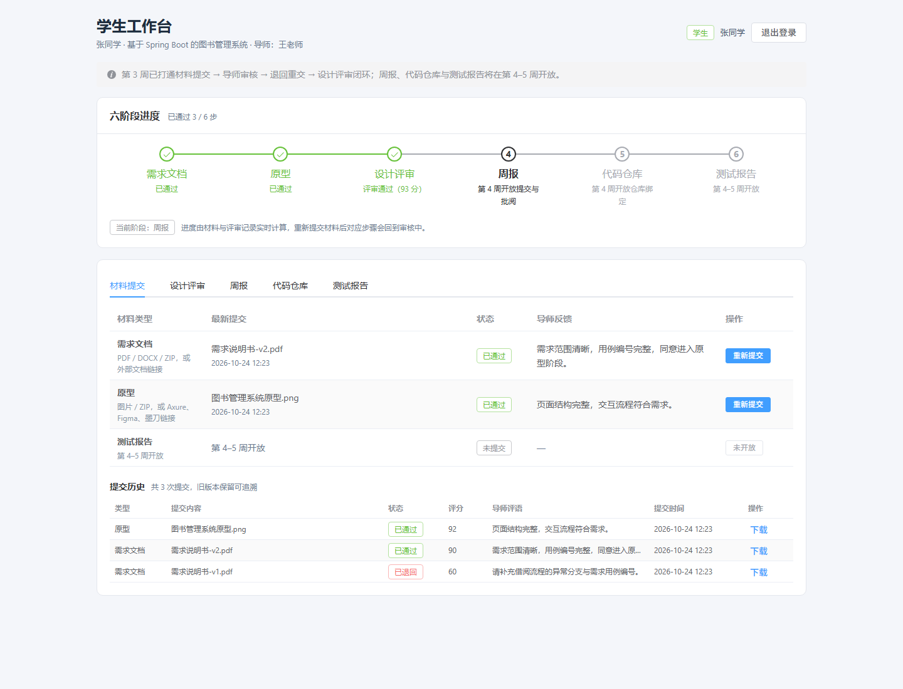
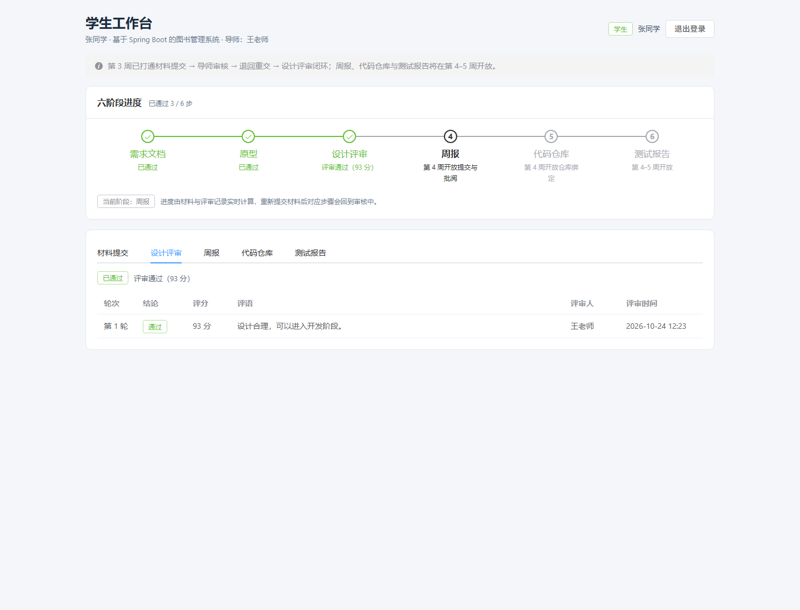
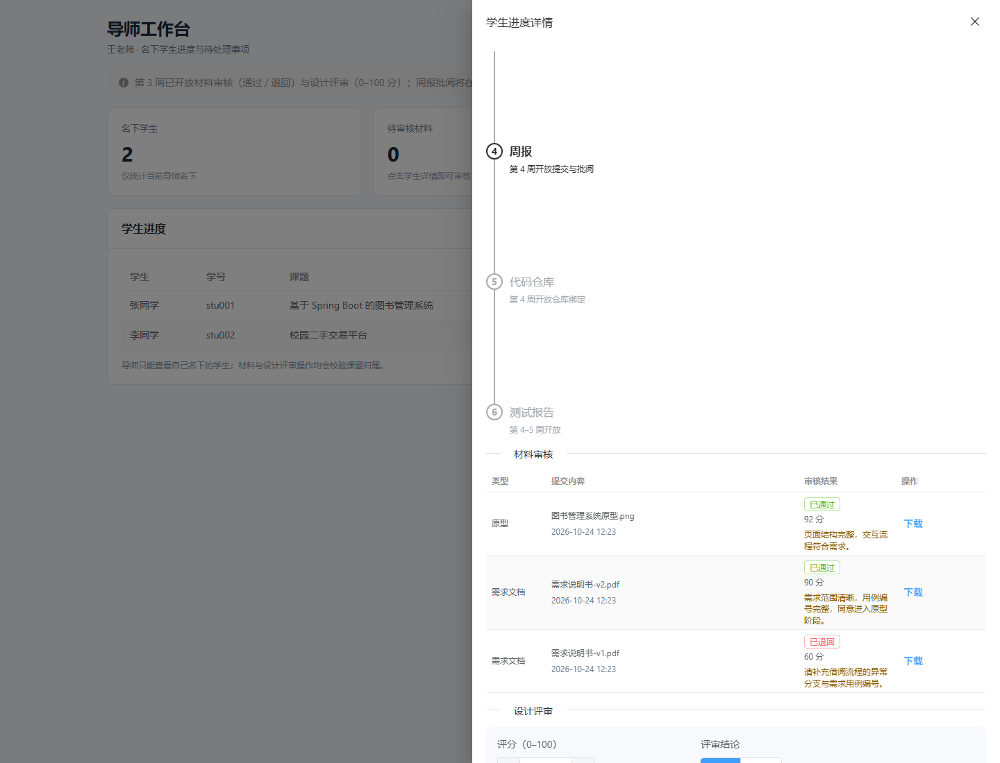
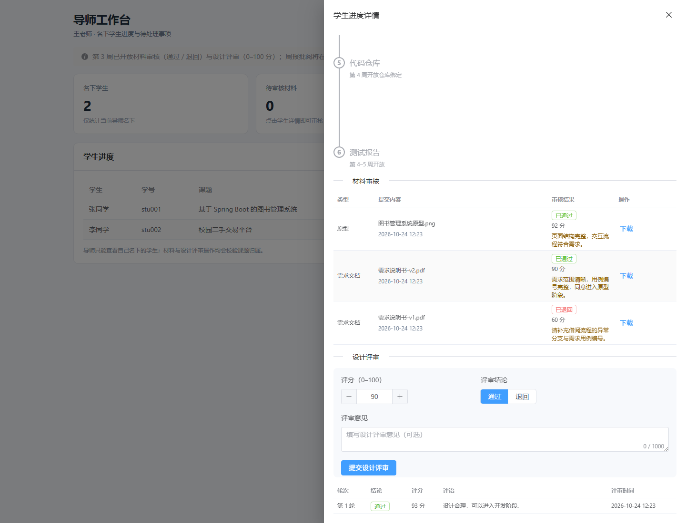

# 实验报告 3

| 项目 | 内容 |
|---|---|
| 课程名称 | 软件工程专业实践课程 |
| 实验名称 | 毕业设计过程管理平台——材料提交、导师审核与设计评审闭环 |
| 实验周次 | 第 3 周（实际完成日期 2026-10-24） |
| 实验学时 | 6 学时 |
| 姓名 | ＿＿＿＿＿＿ |
| 学号 | ＿＿＿＿＿＿ |
| 班级 | ＿＿＿＿＿＿ |
| 实验日期 | 2026 年 10 月 24 日 |

---

## 一、实验目的

1. 实现需求文档与原型的“文件上传 / 外部链接”二选一提交，掌握 Spring MVC `MultipartFile`、文件白名单、大小限制与 UUID 存储。
2. 建立材料状态机 `SUBMITTED → APPROVED / RETURNED`，实现导师通过、退回、评语与退回后重交，并完整保留历史版本。
3. 实现必须登录且校验数据归属的文件下载，防止学生互查和路径穿越。
4. 实现设计评审的 0–100 分评分与 `PASS / RETURN` 结论，并在后端强制校验“最新需求与原型均通过”的前置条件。
5. 将六步进度中的前三步与真实材料、评审记录联动，验证状态变化能实时反映到学生和导师页面。
6. 通过自动化测试、端到端接口检查和真实页面操作验证 M2（核心闭环）里程碑。

---

## 二、实验环境

| 类别 | 环境 / 版本 |
|---|---|
| 操作系统 | Windows 11 Home China（10.0.26200） |
| JDK | Java 21.0.5 |
| 构建工具 | Maven 3.9.15、npm 11.19 |
| 后端框架 | Spring Boot 3.3.5、MyBatis-Plus 3.5.9 |
| 认证组件 | JJWT 0.12.6（HS256）、Spring Security Crypto（BCrypt） |
| 开发数据库 | H2（MySQL 兼容模式、文件持久化） |
| 前端框架 | Vue 3.5、Vite 6.4.4、Element Plus 2.9、Axios、Vue Router |
| 测试工具 | JUnit 5、MockMvc、Python 验收脚本、无头 Chrome（CDP） |
| 启动方式 | `mvn package` + `java -jar`（规避中文路径下 `spring-boot:run` 的问题） |

---

## 三、实验内容与过程

### 3.1 业务闭环与状态机设计

第 3 周的目标不是单独做“上传按钮”，而是形成一条可演示的中期闭环：

```text
学生上传需求 ─► 导师退回（填写评语） ─► 学生查看原因并重交
      ─► 导师通过 ─► 学生上传原型 ─► 导师通过
      ─► 导师设计评审（0–100 分 + PASS/RETURN）
      ─► 学生查看结果；退回则修改材料后重新走评审
```

材料状态机：

| 当前状态 | 允许操作 | 结果 |
|---|---|---|
| 无记录 | 学生提交 | `SUBMITTED` |
| `SUBMITTED` | 导师通过 | `APPROVED` |
| `SUBMITTED` | 导师退回 | `RETURNED`（评语必填） |
| `SUBMITTED` | 学生再次提交 | 拒绝，提示“请勿重复提交” |
| `RETURNED` / `APPROVED` | 学生重新提交 | 新记录 `SUBMITTED`，旧记录保留 |

这样设计的原因：

1. 不用“覆盖更新”破坏历史，导师可以看到学生每一版的提交和反馈；
2. 用“最新一条记录”驱动六步进度，规则简单、可验证；
3. 待审核期间禁止重复提交，避免导师同时看到多条待审记录。

### 3.2 文件上传与鉴权下载

**提交接口**

`POST /api/student/artifacts` 使用 `multipart/form-data`：

| 参数 | 说明 |
|---|---|
| `type` | `REQUIREMENT` / `PROTOTYPE`；`TEST_REPORT` 第 4–5 周开放 |
| `file` | 可选，上传文件 |
| `externalUrl` | 可选，外部链接 |

后端校验顺序：

1. 从 JWT 取学生 id，查询本人课题；
2. 校验类型合法，查询该类型最新记录，若为 `SUBMITTED` 则拒绝；
3. 文件与链接必须二选一；
4. 文件：清洗文件名 → 扩展名白名单 → 大小 ≤20MB → 保存；
5. 外链：长度 ≤500，必须为 `http/https` 且包含 host；
6. 插入 `artifact` 记录，状态 `SUBMITTED`；
7. 若数据库插入失败，删除已落盘文件，避免产生孤儿文件。

**文件存储**

- 根目录：`app.upload.dir`，默认 `../uploads`，可用 `UPLOAD_DIR` 覆盖；
- 相对路径：`{projectId}/{uuid}.{ext}`；
- 数据库同时保存相对路径 `file_path` 和原始文件名 `file_name`；
- 对外 DTO 不返回 `filePath`，只返回 `fileName` 与 `downloadable`。

**下载接口**

`GET /api/files/{artifactId}`：

1. 必须登录（`AuthInterceptor` 保护）；
2. 学生只能下载本人课题材料，导师只能下载名下学生材料，否则 403；
3. 外部链接材料没有文件，返回 400“该材料为外部链接，无文件可下载”；
4. 将相对路径解析并规范化，必须仍位于上传根目录内，阻止 `../` 路径穿越；
5. 文件不存在返回 404；
6. 响应使用 `application/octet-stream`，并通过 UTF-8 编码的 `Content-Disposition` 返回原始文件名。

**前端下载**

JWT 存在 `localStorage`，不能直接用 `<a href>` 下载。前端通过 Axios 携带鉴权头请求 Blob，再用 `URL.createObjectURL` 触发浏览器保存，避免把 Token 拼到 URL 中。

### 3.3 导师材料审核

`POST /api/advisor/artifacts/{artifactId}/review`：

- 校验材料存在、课题存在；
- 校验 `project.advisor_id = 当前导师 id`，否则 403；
- 只有 `SUBMITTED` 可以审核，防止重复操作；
- 结论只允许 `APPROVED` / `RETURNED`；
- 退回必须填写评语；
- 评分可选，范围 0–100；
- 写入 `feedback`、`score`、`reviewed_at`。

前端在导师详情抽屉中展示材料列表：

- 已通过/已退回材料显示评分与评语，并提供下载；
- 待审核材料显示“通过”“退回”按钮；
- 弹窗中评分默认 90，退回时评语必填；
- 操作成功后同时刷新详情抽屉和学生列表统计。

### 3.4 设计评审与前置条件

`POST /api/advisor/projects/{projectId}/design-review`：

1. 校验课题归属；
2. 查询该课题最新 `REQUIREMENT` 和最新 `PROTOTYPE`；
3. 两者必须都存在且状态为 `APPROVED`，否则 400“需求文档与原型均通过后才能进行设计评审”；
4. 评分 0–100，结论 `PASS` / `RETURN`；
5. `round_no = 已有评审数 + 1`；
6. 保存评审人、评语、时间并返回视图。

设计评审与材料审核分离，原因：

- 材料审核回答“这份材料是否合格”；
- 设计评审回答“整体方案是否达到进入开发的标准”，需要综合两份材料；
- 评审可以多轮，保留轮次便于追溯。

### 3.5 六步进度同步

`ProjectProgressService` 第 3 周的计算规则：

| 步骤 | 计算方式 |
|---|---|
| 需求文档 | 最新 `REQUIREMENT` 状态：`APPROVED→COMPLETED`、`SUBMITTED→IN_REVIEW`、`RETURNED→RETURNED`、无记录→`NOT_STARTED` |
| 原型 | 同上，类型为 `PROTOTYPE` |
| 设计评审 | 需求与原型均 `COMPLETED` 后，取最新评审：`PASS→COMPLETED`、`RETURN→RETURNED`；材料未就绪时提示“需求与原型通过后可评审” |
| 周报 / 代码仓库 / 测试报告 | 仍为 `NOT_STARTED`，第 4–5 周接入 |

一个重要的边界：材料通过后允许重新提交。此时最新材料回到 `SUBMITTED`，之前的设计评审不能再算作“当前完成依据”，设计评审步骤随之回到未开始，但评审历史仍保留。这一规则在联调中专门验证。

进度仍按“连续完成的前缀”统计：

- 需求通过、原型通过、评审通过 → `completedStepCount = 3`；
- 需求重新提交 → 第 1 步回到审核中，`completedStepCount = 0`，即使原型和评审记录仍存在。

这样前端只展示后端返回的 `steps`，不需要各自推断。

### 3.6 前端材料与评审页面

**学生工作台**

- 材料汇总表：三行分别对应需求、原型、测试报告；显示最新文件/外链、状态、导师反馈和操作；
- 提交弹窗：
  - 文件模式使用 `el-upload` 拖拽，限制单文件；
  - 外链模式校验 `http/https`；
  - 前端同步校验扩展名与 20MB，减少无效请求；
- 提交历史：展示所有版本、状态、评分、评语、时间和下载；
- 设计评审 Tab：展示当前状态、前置条件提示、历次评审；
- 周报 Tab：列表与操作列骨架，说明第 4 周开放；
- 状态映射与时间格式化统一放在 `utils/status.js`。

**导师工作台**

- 学生列表待处理数量使用徽标；
- 详情抽屉：
  - 纵向六步进度；
  - 材料审核表格：类型、内容、审核结果、评分、评语、下载与审核操作；
  - 设计评审表单：评分、结论、评语；
  - 评审历史表格；
- 抽屉宽度 760px，材料与评审区域纵向排列，避免横向挤压。

### 3.7 测试设计

新增 `ArtifactAndReviewTest`，使用 `@SpringBootTest + MockMvc + test` 配置：

- 测试上传目录 `./target/test-uploads`，单文件上限降为 1KB，避免生成 20MB 文件；
- 每个用例结束后删除 `design_review`、`artifact`、测试项目/导师和上传目录；
- 现有 `AuthAndAccessTest` 的初始状态断言保持通过。

测试用例：

| 编号 | 场景 | 预期 |
|---|---|---|
| T1 | 上传需求 PDF | 200，`SUBMITTED`，返回原始文件名，无 `filePath`，步骤 `IN_REVIEW` |
| T2 | 外链提交原型 | 200，`downloadable=false` |
| T3 | 上传 `.txt` | 400，白名单提示 |
| T4 | 上传 >1KB | 400，大小提示 |
| T5 | 无文件且无链接 | 400，提示二选一 |
| T6 | 文件和外链同时提交 | 400，提示只能选一种 |
| T7 | `javascript:` / `ftp://` | 400，要求 http/https |
| T8 | 待审期间重复提交 | 400，请勿重复提交 |
| T9 | 退回 → 学生重交 | 状态 `RETURNED` → 重交 `SUBMITTED`，导师待审数 1 |
| T10 | 通过后重交 | 步骤回到 `IN_REVIEW`，历史 2 条 |
| T11 | 设计评审前置条件 | 原型待审时 400 |
| T12 | 两份材料均通过后评审 | 200，`roundNo=1`，前三步完成 |
| T13 | 评分 101 / 非法结论 | 400 |
| T14 | 学生下载他人材料 | 403 |
| T15 | 导师下载名下学生文件 / 外链不可下载 | 200 / 400 |
| T16 | 导师审核或评审其他导师课题 | 403 |

> T5/T6、T15/T16 分别对应同一测试方法中的两组断言，因此 16 组场景共由 15 个测试方法实现。

---

## 四、实验结果

### 4.1 交付物

| 交付物 | 位置 | 状态 |
|---|---|---|
| 材料提交、审核、下载服务 | `backend/.../service/ArtifactService.java` | 完成 |
| 设计评审服务 | `backend/.../service/DesignReviewService.java` | 完成 |
| 鉴权下载控制器 | `backend/.../controller/FileController.java` | 完成 |
| 材料与评审 DTO | `backend/.../dto/ArtifactView.java`、`DesignReviewView.java` 等 | 完成 |
| 六步进度同步 | `backend/.../service/ProjectProgressService.java` | 完成 |
| 材料与评审测试 | `backend/src/test/java/.../ArtifactAndReviewTest.java` | 完成（15 个用例） |
| 学生材料 / 评审页面 | `frontend/src/views/StudentWorkbenchView.vue` | 完成 |
| 导师审核 / 评审抽屉 | `frontend/src/views/AdvisorHomeView.vue` | 完成 |
| 鉴权下载工具 | `frontend/src/api/files.js` | 完成 |
| 页面截图 | `docs/screenshots/week3-*.png` | 完成（4 张） |
| 第 3 周进度记录 | `开发进度.md` | 完成 |

### 4.2 自动化测试结果

```text
ArtifactAndReviewTest  Tests run: 15, Failures: 0, Errors: 0, Skipped: 0
AuthAndAccessTest      Tests run: 10, Failures: 0, Errors: 0, Skipped: 0
HealthControllerTest   Tests run: 1,  Failures: 0, Errors: 0, Skipped: 0
合计 26 个测试全部通过
```

### 4.3 前端构建结果

```text
vite v6.4.4
1680 modules transformed
dist/assets/index-*.css  366.83 kB
dist/assets/index-*.js 1,138.25 kB
✓ built in 8.92s
```

构建成功，仍有 chunk 体积提示，属于 Element Plus 全量引入的已知非阻塞项。

### 4.4 端到端接口联调结果

使用独立内存数据库启动后端，按真实用户顺序执行 28 项检查，全部通过：

| 阶段 | 检查内容 | 结果 |
|---|---|---|
| 登录 | 学生、导师、另一名学生登录 | 通过 |
| 首次提交 | 需求文件上传、原始文件名、无存储路径泄漏、步骤 `IN_REVIEW`、导师待审 1 条 | 通过 |
| 退回 | 未填评语 400；填写评语后退回成功；学生步骤 `RETURNED` | 通过 |
| 重交与重复提交 | 重交成功；待审期间再次提交 400 | 通过 |
| 审核通过 | 通过后步骤 `COMPLETED` | 通过 |
| 下载与越权 | 导师下载内容一致；其他学生下载 403 | 通过 |
| 原型 | 非法链接 400；外链提交成功；外链不可下载 | 通过 |
| 设计评审前置 | 原型未通过时评审 400 | 通过 |
| 设计评审 | 评分 101 拒绝；PASS 成功，`roundNo=1` | 通过 |
| 进度 | 前三步完成 3/6；历史 3 条；评审 1 条 | 通过 |
| 重交回退 | 通过后重交，需求回到审核中，完成数回退到 0，评审历史保留 | 通过 |
| 白名单 | `.txt` 拒绝 | 通过 |

### 4.5 页面运行结果

使用无头 Chrome（通过 CDP 注入登录态）实际打开页面：

- 学生材料页：需求 v1 退回、v2 通过、原型通过、3 条历史、导师评语与下载按钮正常；
- 学生设计评审页：93 分、通过结论、第 1 轮、评审人、时间正常；
- 导师材料审核：三种材料状态、评分、评语、下载正常；
- 导师设计评审：评分、结论、评语表单与历史表格正常；
- 页面运行时错误：**0**。

学生材料页：



学生设计评审页：



导师材料审核：



导师设计评审：



### 4.6 实验结论

- 第 3 周计划的 6 学时任务全部完成，M2 达成；
- 材料上传、外链提交、退回重交、审核通过、设计评审已形成闭环；
- 文件类型、大小、URL、重复提交、前置条件和归属权限均由后端强制校验；
- 六步进度与材料/评审记录同步，重新提交后的回退行为符合预期；
- 按计划交付量计算，累计完成 17.5 / 33 学时，进度 **53.0%**，与计划一致；
- 第 4 周可以直接复用材料上传与审核逻辑开放测试报告，并新增周报和仓库绑定。

---

## 五、遇到的问题与解决方法

### 问题 1：已有 H2 开发库缺少新字段

**现象**：第 3 周为 `artifact` 增加 `file_name` 字段，但第 1–2 周创建的文件库已经存在，直接修改 `CREATE TABLE` 不会生效。

**解决**：

- `schema.sql` 在建表语句后增加幂等迁移：

```sql
ALTER TABLE artifact ADD COLUMN IF NOT EXISTS file_name VARCHAR(255);
```

- 同步更新 `db/schema-mysql.sql`；
- 新库由 `CREATE TABLE` 直接包含字段，旧库由 `ALTER` 补齐，两种启动方式都不报错。

### 问题 2：中文文件名下载乱码

**现象**：使用简单的 `Content-Disposition: attachment; filename=...` 时，中文文件名在浏览器中可能乱码。

**解决**：使用 Spring 的 `ContentDisposition.attachment().filename(name, StandardCharsets.UTF_8)`，生成 RFC 5987 的 `filename*=UTF-8''...` 形式，浏览器可正确还原中文文件名。

### 问题 3：Blob 下载失败时前端拿不到后端提示

**现象**：下载接口使用 `responseType: 'blob'`，当后端返回 400/403 JSON 时，Axios 错误中的 `data` 是 Blob，原有拦截器读不到 `message`，页面只能显示 “Request failed with status code 403”。

**解决**：在响应拦截器中判断 `error.response.data instanceof Blob`，异步读取文本并 `JSON.parse`，提取后端 `message`；这样“无权下载”“外部链接无文件”等提示可以原样展示。

### 问题 4：测试上传目录与开发库互相污染

**现象**：测试若使用默认 `../uploads`，会向项目目录写文件，且清理不彻底。

**解决**：

- `application-test.yml` 将上传目录改为 `./target/test-uploads`；
- 将单文件上限降为 1KB，避免测试生成大文件；
- `@AfterEach` 递归删除测试上传目录，并清理测试材料、评审、项目与导师数据；
- 测试类运行后，原有 10 个认证测试仍保持通过。

### 问题 5：重新提交后的进度语义

**现象**：联调脚本最初预期“设计评审已通过后，重新提交需求，完成数仍为 2”，实际返回 0。

**分析**：需求是第 1 步，重新提交后第 1 步回到 `IN_REVIEW`，按“连续完成前缀”规则，后续步骤不能再计入完成数。这正是预期语义：材料更新后必须重新审核，旧设计评审不能继续作为当前完成依据。

**解决**：保留后端规则，修正验收脚本断言为 0，并增加“设计评审历史仍保留”的检查；在实验报告和进度文档中明确该规则。

### 问题 6：外部链接与文件同时提交

**现象**：如果只校验“至少有一个”，学生可能同时提交文件和链接，导师无法判断以哪个为准。

**解决**：后端明确要求二选一：两者都有返回“文件与外部链接只能选择一种方式”；前端用单选按钮切换模式，只发送其中一种。

### 问题 7：第 3 周功能与第 4 周占位的边界

**现象**：材料页原本包含测试报告行，若直接全部开放会超出第 3 周范围。

**解决**：

- 需求与原型开放提交；
- 测试报告行保留但按钮禁用，提示“第 4–5 周开放”；
- 后端 `normalizeType` 对 `TEST_REPORT` 返回明确提示，防止绕过前端直接调用；
- 周报 Tab 只做列表骨架，不接数据，避免与第 4 周状态机冲突。

---

## 六、实验总结

本周把“能登录、能看到进度”推进到“能提交、能审核、能退回、能重交、能评审”。实现过程中最重要的三条经验：

1. **权限必须落在业务层**：拦截器只能区分角色，无法判断某个材料属于谁；下载、审核、评审都在 Service 层再次校验课题归属，才能防止猜到 id 的横向越权。
2. **状态机要有明确的历史语义**：采用“插入新记录而不是覆盖”的方式，使退回、重交、评审轮次都可以追溯，也让“最新版本驱动进度”的规则足够简单。
3. **边界条件先写测试**：文件与链接二选一、待审重复提交、退回必填评语、设计评审前置条件、外链不可下载，这些边界在写页面前先用 MockMvc 固化，前端联调时问题明显减少。

通过 26 个自动化测试、28 项端到端接口检查和一次真实页面操作，M2 里程碑得到验证。当前累计进度 53.0%，第 4 周将在现有材料能力上开放测试报告，并新增周报与仓库关联，向 M3（69.7%）推进。

---

## 七、下周计划

第 4 周（5.5 学时）目标：完成周报、代码仓库关联和测试报告基础版，累计进度达到 69.7%（M3）。

| 任务 | 计划学时 | 验收标准 |
|---|---:|---|
| 周报提交、导师批阅、状态与列表 | 1.5 | 学生可提交、导师可批阅，状态同步 |
| 绑定公开 GitHub/Gitee 仓库、手动同步、失败兜底 | 3 | 显示 commit 总数与最近提交；断网可手工填写 |
| 测试报告表单 + 附件、复用材料审核 | 0.5 | 学生提交、导师审核、六步进度完成 |
| 实验报告 4 | 0.5 | 文档与实现一致 |

第 4 周末执行 M3 验收：同一学生走完六个环节，仓库同步失败时仍可通过手工兜底完成演示，导师端待办统计包含周报与测试报告。
