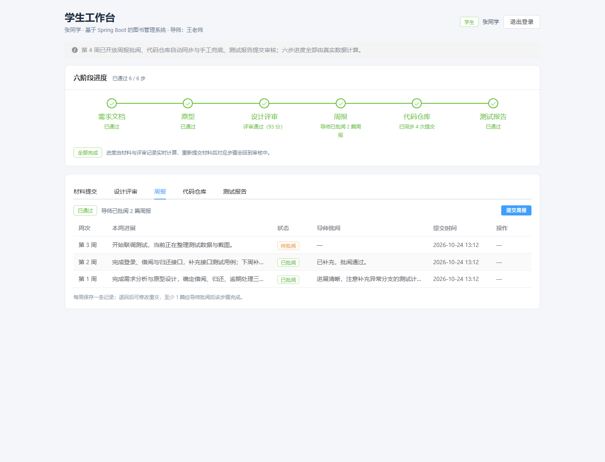
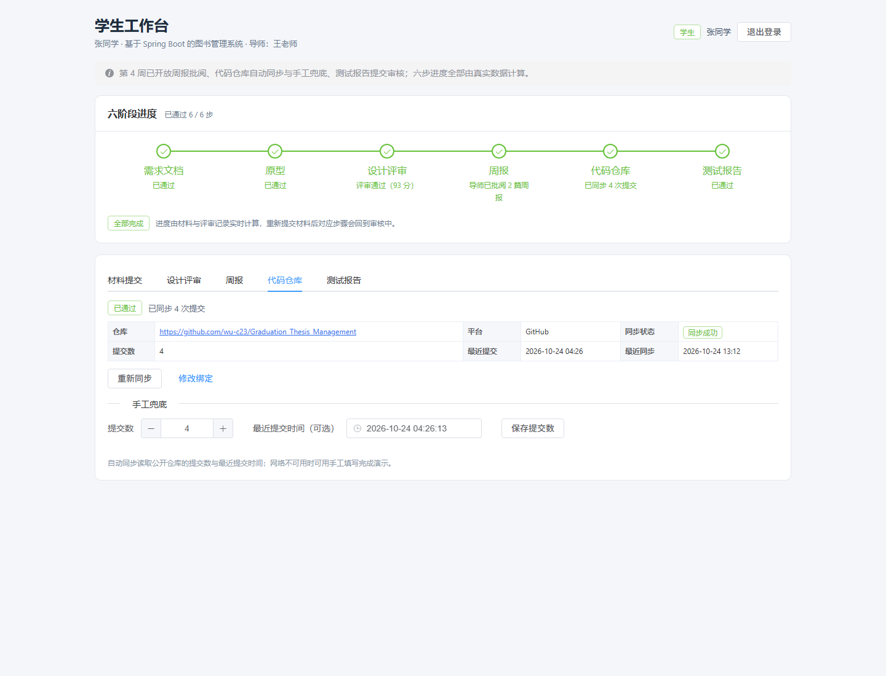
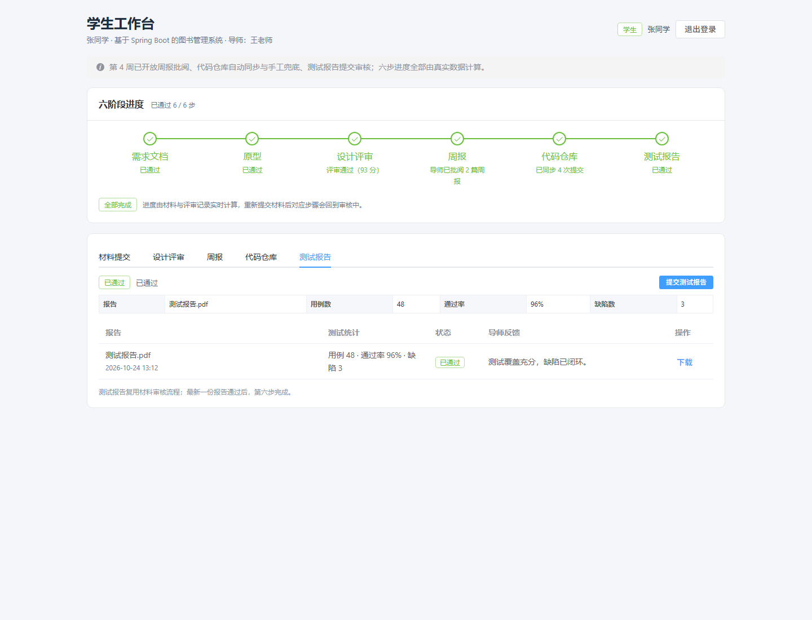
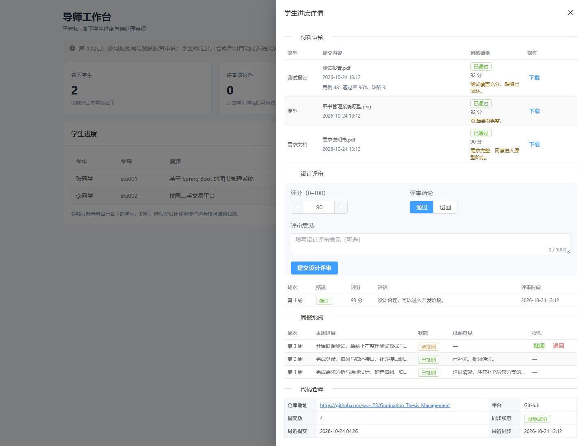

# 实验报告 4

| 项目 | 内容 |
|---|---|
| 课程名称 | 软件工程专业实践课程 |
| 实验名称 | 毕业设计过程管理平台——周报、代码仓库关联与测试报告 |
| 实验周次 | 第 4 周（实际完成日期 2026-10-24） |
| 实验学时 | 5.5 学时 |
| 姓名 | ＿＿＿＿＿＿ |
| 学号 | ＿＿＿＿＿＿ |
| 班级 | ＿＿＿＿＿＿ |
| 实验日期 | 2026 年 10 月 24 日 |

---

## 一、实验目的

1. 实现按周提交周报、导师批阅与退回重交，建立 `SUBMITTED → REVIEWED / RETURNED` 状态机，并将待批阅周报计入导师待办。
2. 实现公开 GitHub / Gitee 仓库绑定，自动读取提交总数与最近提交时间；网络或 API 不可用时提供手工填写兜底。
3. 复用材料提交与审核流程开放测试报告，并保存用例数、通过率、缺陷数三项测试统计。
4. 将六步进度中的第 4–6 步改为真实计算，使同一学生可以完成完整六步链路。
5. 完成学生端周报 / 仓库 / 测试报告页面与导师端周报批阅、仓库查看界面。
6. 通过自动化测试、端到端接口检查、真实仓库同步和页面操作验证 M3（六步全链路）里程碑。

---

## 二、实验环境

| 类别 | 环境 / 版本 |
|---|---|
| 操作系统 | Windows 11 Home China（10.0.26200） |
| JDK | Java 21.0.5 |
| 构建工具 | Maven 3.9.15、npm 11.19 |
| 后端框架 | Spring Boot 3.3.5、MyBatis-Plus 3.5.9 |
| 认证组件 | JJWT 0.12.6（HS256）、Spring Security Crypto（BCrypt） |
| 开发数据库 | H2（MySQL 兼容模式、文件持久化） |
| 前端框架 | Vue 3.5、Vite 6.4.4、Element Plus 2.9、Axios、Vue Router |
| 外部接口 | GitHub REST API、Gitee OpenAPI v5（均无需 Token） |
| 测试工具 | JUnit 5、MockMvc、Python 验收脚本、无头 Chrome（CDP） |
| 启动方式 | `mvn package` + `java -jar`（规避中文路径下 `spring-boot:run` 的问题） |

---

## 三、实验内容与过程

### 3.1 六步链路的最后三个环节

第 3 周已经打通“需求 → 原型 → 设计评审”。本周补齐后三个环节，形成完整链路：

```text
需求通过 ─► 原型通过 ─► 设计评审 PASS
  ─► 学生提交周报 ─► 导师批阅（可退回重交）
  ─► 学生绑定代码仓库 ─► 自动同步 / 手工兜底
  ─► 学生提交测试报告（用例数 / 通过率 / 缺陷数）
  ─► 导师审核通过 ─► 六步完成
```

六步完成条件：

| 步骤 | 完成条件 |
|---|---|
| 1 需求文档 | 最新 `REQUIREMENT` 为 `APPROVED` |
| 2 原型 | 最新 `PROTOTYPE` 为 `APPROVED` |
| 3 设计评审 | 最新设计评审为 `PASS`，且需求与原型均通过 |
| 4 周报 | 该课题至少 1 篇周报为 `REVIEWED` |
| 5 代码仓库 | 已绑定仓库且最近一次同步为 `SUCCESS` |
| 6 测试报告 | 最新 `TEST_REPORT` 为 `APPROVED` |

总进度仍按“连续完成前缀”统计，避免出现第 3 步未完成但第 4 步已完成的展示矛盾。

### 3.2 周报状态机与唯一性设计

**表结构**：`weekly_report(id, project_id, week_no, content, status, comment, submitted_at, reviewed_at)`，并对 `(project_id, week_no)` 建唯一索引。

状态机：

| 当前状态 | 允许操作 | 结果 |
|---|---|---|
| 无记录 | 学生提交 | `SUBMITTED` |
| `SUBMITTED` | 导师通过 | `REVIEWED`，可写评语 |
| `SUBMITTED` | 导师退回 | `RETURNED`，评语必填 |
| `SUBMITTED` / `REVIEWED` | 学生再提交同一周 | 拒绝，提示该周周报已提交或已批阅 |
| `RETURNED` | 学生修改后重交 | 覆盖原记录，清空评语与批阅时间，回到 `SUBMITTED` |

为什么不保留周报历史版本：

- 周报是过程性记录，同一周只应有最终结论，保留多版本会让“哪一版算数”变得模糊；
- 材料需要留存版本是为了追溯正式交付物，而周报的修订过程本身不是交付物；
- 覆盖式重交让 `(project_id, week_no)` 唯一约束真正生效，查询和统计都更简单。

导师待批阅统计：

- `GET /api/advisor/students` 返回 `pendingWeeklyReportCount`；
- 每名学生的 `pendingCount` = 待审核材料数 + 待批阅周报数；
- 学生列表徽标与详情抽屉使用同一统计口径。

### 3.3 代码仓库绑定与同步

**绑定** `POST /api/student/repo-binding`：

1. 只接受 `https://github.com/{owner}/{repo}`、`https://gitee.com/{owner}/{repo}`，可带 `www.` 与 `.git` 后缀；
2. 拒绝查询参数、锚点、多余路径段、非法字符；
3. 规范化后保存：去掉末尾 `/` 与 `.git`，仓库名保留原始大小写；
4. 重新绑定会清空旧的同步状态，避免展示上一个仓库的提交数。

**同步** `POST /api/student/repo-binding/sync`：

- GitHub：`GET https://api.github.com/repos/{owner}/{repo}/commits?per_page=1`，从 `Link` 响应头的 `rel="last"` 分页链接读取总页数，即提交总数；
- Gitee：`GET https://gitee.com/api/v5/repos/{owner}/{repo}/commits?per_page=1`，优先读取 `X-Total-Count`，没有时再解析 `Link`；
- 连接超时 3 秒、请求超时 5 秒；
- 从第一页第一条提交读取最近提交时间；
- 成功写入 `commitCount`、`latestCommitAt`、`lastSyncAt`、`SUCCESS`；
- 任何异常（网络、4xx/5xx、解析失败）写入 `FAILED`，接口仍返回 200，让前端进入兜底引导而不是弹一个不可操作的错误。

**手工兜底** `POST /api/student/repo-binding/manual-count`：

- 必须先绑定仓库；
- `commitCount` 为 0–100000 的整数；
- 最近提交时间不得晚于当前时间；
- 保存后状态置为 `SUCCESS`，第 5 步可以完成。

**安全考虑**：不把用户输入的 URL 直接交给 HTTP 客户端，而是解析出 owner / repo 后拼接固定的 API 地址，避免 SSRF 和任意地址探测；只支持公开仓库，不引入 OAuth。

### 3.4 测试报告与测试统计

测试报告复用第 3 周的材料模型，只做两处扩展：

1. `ArtifactService.SUBMITTABLE_TYPES` 增加 `TEST_REPORT`；
2. `artifact` 表增加 `test_case_count`、`test_pass_rate`、`defect_count` 三列。

校验规则：

- 三项统计只允许在 `TEST_REPORT` 类型填写，其他类型带统计返回 400；
- 用例数、缺陷数 ≥ 0；
- 通过率在 0–100 之间；
- 三项均可选，允许仅上传报告文件。

导师审核沿用材料审核接口 `POST /api/advisor/artifacts/{artifactId}/review`，通过后第 6 步完成。

### 3.5 进度服务与导师统计

`ProjectProgressService` 新增：

- `weeklyStep`：有 `REVIEWED` → `COMPLETED`（“导师已批阅 N 篇周报”）；有待批阅 → `IN_REVIEW`；否则展示退回状态；
- `repoStep`：未绑定 → `NOT_STARTED`；`SUCCESS` → `COMPLETED`（“已同步 N 次提交”）；`FAILED` → `RETURNED`；已绑定未同步 → 新增的 `IN_PROGRESS`（“仓库已绑定，等待同步”）；
- `artifactStep(TEST_REPORT)`：复用材料步骤逻辑，补上测试报告名称与提示。

学生项目接口 `GET /api/student/project` 同时返回 `weeklyReports` 列表与 `repoBinding`，前端不再需要额外请求即可渲染三个新页面。

导师统计新增待批阅周报查询；`pendingCount` 与列表徽标同步更新。

### 3.6 前端页面

**学生工作台**

- 周报 Tab：周次、状态、提交/批阅时间、导师评语、退回后“修改重交”按钮；提交弹窗限制 1–30 周、2000 字；
- 代码仓库 Tab：绑定表单（地址 + 自动同步）、仓库信息卡片、重新同步、修改绑定；同步失败显示警告与“手工填写”入口；
- 测试报告 Tab：最新报告摘要、测试统计、提交入口、历史记录与下载；
- 提交材料弹窗在类型为测试报告时显示三项统计输入，其余类型隐藏；只在有值时附加到 `FormData`。

**导师工作台**

- 材料表格展示测试报告的用例数、通过率与缺陷数；
- 详情抽屉新增“周报批阅”区：周次、内容、状态、评语、批阅 / 退回按钮；
- 详情抽屉新增“代码仓库”区：地址、平台、同步状态、提交数、最近提交、最近同步时间；
- 批阅弹窗支持通过 / 退回，退回时评语必填。

状态展示统一放在 `utils/status.js`，新增 `IN_PROGRESS` 步骤、周报状态与仓库同步状态三组映射。

### 3.7 测试设计

新增 `WeeklyRepoAndTestReportTest`（7 个测试方法）：

| 编号 | 场景 | 预期 |
|---|---|---|
| T1 | 提交周报 → 导师批阅 | 第 4 步 `IN_REVIEW` → `COMPLETED`，导师待批阅数 1 → 0 |
| T2 | 退回不填评语 / 退回后重交 / 待批阅重复提交 | 400 / 同一 id 重交为 `SUBMITTED` / 400 |
| T3 | 另一位导师批阅或查看周报 | 403 |
| T4 | 非法仓库地址 / 绑定规范化 / 手工填写 42 | 400 / 地址去掉 `.git` / 第 5 步完成，最近提交时间保留 |
| T5 | 未绑定直接手工填写 / 负数 / 未来时间 | 400，分别提示 |
| T6 | 测试报告带统计提交并通过审核 | 统计保存，第 6 步完成，六步完成数 6 |
| T7 | 通过率 101 / 在 `REQUIREMENT` 上填统计 | 400，提示范围与类型限制 |

同步逻辑不依赖外网：

- 单元测试只覆盖 URL 校验、绑定规范化与手工兜底；
- 真实 GitHub 自动同步放在端到端验收中执行，避免测试因网络波动失败；
- 同步失败用“写入 `FAILED` 并返回 200”的分支保证前端可继续演示。

测试隔离：

- 每个测试类在 `@AfterEach` 清理 `weekly_report`、`repo_binding`、`design_review`、`artifact`、测试项目/用户；
- 同步修改第 3 周测试的清理逻辑，防止周报与仓库数据跨测试污染；
- 健康检查测试的阶段字段更新为 `week-4-weekly-repo-test`。

---

## 四、实验结果

### 4.1 交付物

| 交付物 | 位置 | 状态 |
|---|---|---|
| 周报实体 / Mapper / 服务 | `backend/.../entity/WeeklyReport.java`、`service/WeeklyReportService.java` | 完成 |
| 仓库绑定实体 / Mapper / 服务 | `backend/.../entity/RepoBinding.java`、`service/RepoBindingService.java` | 完成 |
| 周报与仓库 DTO | `backend/.../dto/WeeklyReport*.java`、`RepoBinding*.java` | 完成 |
| 测试报告统计字段 | `entity/Artifact.java`、`dto/ArtifactView.java`、`schema.sql` | 完成 |
| 六步进度第 4–6 步 | `service/ProjectProgressService.java` | 完成 |
| 学生 / 导师接口 | `controller/StudentController.java`、`AdvisorController.java` | 完成 |
| 周报 / 仓库 / 测试报告测试 | `backend/src/test/java/.../WeeklyRepoAndTestReportTest.java` | 完成（7 个用例） |
| 学生三个页面 | `frontend/src/views/StudentWorkbenchView.vue` | 完成 |
| 导师周报 / 仓库界面 | `frontend/src/views/AdvisorHomeView.vue` | 完成 |
| 页面截图 | `docs/screenshots/week4-*.png` | 完成（4 张） |
| 第 4 周进度记录 | `开发进度.md`、`README.md` | 完成 |

### 4.2 自动化测试结果

```text
ArtifactAndReviewTest          Tests run: 15, Failures: 0, Errors: 0, Skipped: 0
AuthAndAccessTest              Tests run: 10, Failures: 0, Errors: 0, Skipped: 0
HealthControllerTest           Tests run: 1,  Failures: 0, Errors: 0, Skipped: 0
WeeklyRepoAndTestReportTest    Tests run: 7,  Failures: 0, Errors: 0, Skipped: 0
合计 33 个测试全部通过
```

### 4.3 前端构建结果

```text
vite v6.4.4
1680 modules transformed
dist/index.html                    0.57 kB │ gzip:   0.37 kB
dist/assets/index-CFXxHeHQ.css   367.57 kB │ gzip:  49.72 kB
dist/assets/index-BLcOow7N.js  1,155.30 kB │ gzip: 378.68 kB
✓ built in 9.13s
```

构建成功，仍有 chunk 体积提示，属于 Element Plus 全量引入的已知非阻塞项。

### 4.4 端到端接口联调结果

使用真实开发库启动后端，按“新学生走完六步”的顺序执行 23 项检查，全部通过：

| 阶段 | 检查内容 | 结果 |
|---|---|---|
| 初始状态 | 六步均未完成，第 4–6 步为 `NOT_STARTED` | 通过 |
| 前三步 | 需求 / 原型审核通过、设计评审 `PASS`，完成数 3 | 通过 |
| 周报提交 | `SUBMITTED`，第 4 步 `IN_REVIEW`，导师待批阅 1 | 通过 |
| 周报批阅 | 导师批阅后第 4 步 `COMPLETED` | 通过 |
| 仓库地址 | `gitlab.com` 地址被拒绝 | 通过 |
| 仓库绑定 | 绑定后地址规范化为 `https://github.com/wu-c23/Graduation_Thesis_Management`，第 5 步 `IN_PROGRESS` | 通过 |
| 自动同步 | 真实 GitHub API 同步成功，提交数 4，第 5 步 `COMPLETED` | 通过 |
| 测试报告 | 提交 48 用例 / 96% 通过率 / 3 缺陷，统计保存，第 6 步 `IN_REVIEW` | 通过 |
| 测试报告审核 | 通过后六步完成数 6、`allCompleted = true` | 通过 |
| 退回重交 | 第 2 周周报退回后原地重交，id 不变，状态回到 `SUBMITTED` | 通过 |
| 状态回退 | 新增第 3 周待批阅周报后，第 4 步仍为 `COMPLETED` | 通过 |
| 导师视图 | 详情返回 3 篇周报；待批阅计数为 1 | 通过 |

### 4.5 页面运行结果

使用无头 Chrome（通过 CDP 注入登录态）实际打开页面：

- 学生周报页：3 篇周报，含已批阅、待批阅、退回重交状态与导师评语；
- 学生代码仓库页：仓库地址、平台、同步成功、提交数 4、最近提交与最近同步时间；
- 学生测试报告页：48 个用例、96% 通过率、3 个缺陷与下载按钮；
- 导师详情：周报批阅区与仓库区同屏可见，批阅按钮与仓库统计正常；
- 页面运行时错误：**0**。

学生周报页：



学生代码仓库页：



学生测试报告页：



导师周报批阅与仓库信息：



### 4.6 实验结论

- 第 4 周计划的 5.5 学时任务全部完成，M3 达成；
- 周报提交、批阅、退回重交形成闭环，导师待办统计可用；
- 仓库绑定、自动同步、手工兜底三条路径均验证通过，真实 GitHub 仓库同步成功；
- 测试报告复用材料链路并保存测试统计，审核通过后六步全部完成；
- 进度服务对新增周报保持“不回退已完成步骤”的稳定语义；
- 按计划交付量计算，累计完成 23 / 33 学时，进度 **69.7%**，与计划一致；
- 第 5 周可以在不新增核心功能的前提下完成导师总览、全链路联调与部署文档。

---

## 五、遇到的问题与解决方法

### 问题 1：仓库地址规范化把仓库名转成了小写

**现象**：最初在规范化时对整个地址调用 `toLowerCase()`，导致 `Graduation_Thesis_Management` 被保存成 `graduation_thesis_management`，与验收脚本期望不一致。

**解决**：只对协议和域名做统一处理，`owner` / `repo` 保留原始大小写；仅在判断 `.git` 后缀时使用小写比较，然后按原长度截取。这样既能识别 `.GIT`，又不会破坏 GitHub 仓库名的大小写。

### 问题 2：同步失败的业务语义

**现象**：最初让同步失败直接抛异常返回 500，前端只能弹出“请求失败”，无法引导用户去手工填写。

**解决**：把“同步失败”视为一种可预期的业务结果：捕获所有异常，写入 `syncStatus = FAILED` 与 `lastSyncAt`，接口返回 200 和当前视图。前端根据 `FAILED` 展示警示和手工填写入口，用户仍可完成第 5 步。

### 问题 3：公开 API 的提交总数口径不一致

**现象**：GitHub 不在响应体里直接返回总数，Gitee 返回 `X-Total-Count`，两者的分页头格式不同。

**解决**：GitHub 解析 `Link` 响应头中 `rel="last"` 的页码；Gitee 优先读 `X-Total-Count`，缺失时回退解析 `Link`。两者都拿不到时返回 1（至少有一条提交），并在界面提示可使用手工填写；该限制已写入 `开发进度.md`。

### 问题 4：退回重交后的评语断言失败

**现象**：测试断言重交后的 `comment` “不存在”，但接口实际返回 `"comment": null`，MockMvc 的 `doesNotExist()` 不适用。

**解决**：改为断言 `value(nullValue())`，明确表达“字段存在但为空”的语义，与前端清空评语的实现一致。

### 问题 5：新增表导致旧测试互相污染

**现象**：第 3 周的测试类只清理 `artifact`、`design_review` 等表；运行顺序变化后，残留的周报和仓库数据会影响新测试的进度断言。

**解决**：在所有涉及项目数据的测试类 `@AfterEach` 中统一增加 `weekly_report`、`repo_binding` 的删除，并保持删除顺序为先子表后主表；完整测试套件连续运行通过。

### 问题 6：导师端周报与仓库截图重复

**现象**：捕获两张截图时，抽屉已经滚动到相同位置，`week4-advisor-repo.png` 与周报截图内容重复。

**解决**：删除多余截图，保留一张同时包含周报批阅与仓库信息的 `week4-advisor-weekly.png`，避免报告中出现无信息增量的重复证据。

### 问题 7：旧数据库缺少新字段与新表

**现象**：第 1–3 周创建的 H2 文件库已存在，仅修改 `CREATE TABLE` 不会给旧库补列。

**解决**：

- `schema.sql` 对 `artifact` 的三项测试统计列使用 `ALTER TABLE ... ADD COLUMN IF NOT EXISTS`；
- 新建 `weekly_report`、`repo_binding` 使用 `CREATE TABLE IF NOT EXISTS`，并对周报追加唯一索引；
- `db/schema-mysql.sql` 同步增加列与 `UNIQUE KEY uk_weekly_report_project_week`。

---

## 六、实验总结

本周把系统从“中期闭环”推进到“六步全链路”。实现过程中最重要的三条经验：

1. **外部依赖必须设计降级路径**：仓库同步依赖第三方 API，限流、断网、分页格式变化都可能发生。把失败建模成业务状态而不是异常，配合手工填写，才能保证演示和真实使用都不被单一外部服务卡住。
2. **不同业务对象要有不同的历史语义**：材料采用“新增版本 + 保留历史”，周报采用“按周唯一 + 原地重交”。前者服务于正式交付物的追溯，后者服务于过程记录的最终结论，不能机械复用同一套模型。
3. **统计口径集中在一处**：导师待办、六步进度、学生列表徽标都从同一服务读取，避免周报接入后出现“进度已完成但待办仍为 0”之类的口径分裂。

通过 33 个自动化测试、23 项端到端接口检查、一次真实 GitHub 同步和一次真实页面操作，M3 里程碑得到验证。当前累计进度 69.7%，第 5 周将完成导师总览、异常路径联调与部署文档，向 M4（86.4%）推进。

---

## 七、下周计划

第 5 周（5.5 学时）目标：完成导师总览、系统级联调与部署文档，功能冻结，累计进度达到 86.4%（M4）。

| 任务 | 计划学时 | 验收标准 |
|---|---:|---|
| 导师总览（进度矩阵、完成率、待批阅汇总） | 1.5 | 一屏看清所有学生状态 |
| 全链路联调（含退回重交、同步失败等异常路径） | 2 | 双角色关键路径回归通过 |
| 打包脚本与部署 / 运行文档 | 1.5 | 新目录按文档可启动 |
| 实验报告 5 | 0.5 | 文档与实现一致 |

第 5 周末执行 M4 验收：两名学生、一名导师完成六步全链路，至少验证 2 条异常路径，并在新目录按文档完成一次构建与启动。
