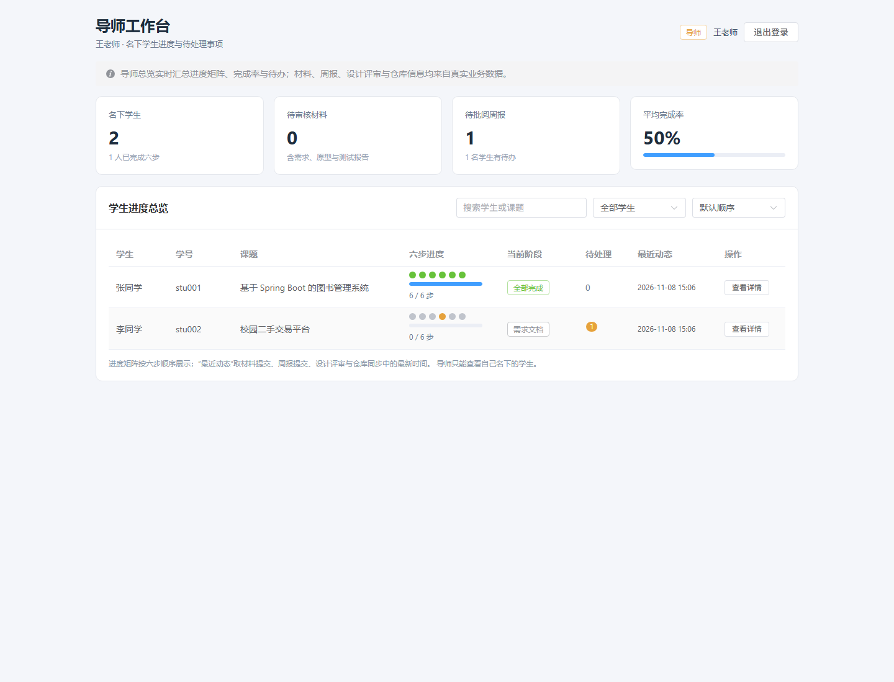

# 实验报告 5

| 项目 | 内容 |
|---|---|
| 课程名称 | 软件工程专业实践课程 |
| 实验名称 | 毕业设计过程管理平台——导师总览、全链路联调与功能冻结 |
| 实验周次 | 第 5 周（实际完成日期 2026-11-08） |
| 实验学时 | 5.5 学时 |
| 姓名 | ＿＿＿＿＿＿ |
| 学号 | ＿＿＿＿＿＿ |
| 班级 | ＿＿＿＿＿＿ |
| 实验日期 | 2026 年 11 月 8 日 |

---

## 一、实验目的

1. 实现导师端批量总览：一屏展示名下学生、六步进度矩阵、平均完成率、待办汇总与最近动态。
2. 在不改变既有业务规则的前提下，扩展 `/api/advisor/students` 聚合响应，避免前端重复计算进度。
3. 按计划完成 8 条手工验收与端到端接口检查，覆盖退回重交、设计评审前置条件、仓库兜底、测试报告退回等异常路径。
4. 完成本地构建与运行说明，冻结功能范围，为第 6 周回归和答辩准备提供稳定基线。
5. 因暂无服务器，本次不执行线上部署，仅验证本地构建、启动与运行文档的可执行性。

---

## 二、实验环境

| 类别 | 环境 / 版本 |
|---|---|
| 操作系统 | Windows 11 Home China（10.0.26200） |
| JDK | Java 21.0.5 |
| 构建工具 | Maven 3.9.15、npm 11.19 |
| 后端框架 | Spring Boot 3.3.5、MyBatis-Plus 3.5.9 |
| 开发数据库 | H2（MySQL 兼容模式、文件持久化） |
| 前端框架 | Vue 3.5、Vite 6.4.4、Element Plus 2.9 |
| 测试工具 | JUnit 5、MockMvc、Python 验收脚本、无头 Chrome（CDP） |
| 部署约束 | 暂无服务器，不执行线上部署 |

---

## 三、实验内容与过程

### 3.1 导师总览的数据口径

总览直接复用学生端六步进度服务，避免出现“学生页显示 6/6、导师页显示 4/6”的口径分裂。`GET /api/advisor/students` 在原有字段基础上增加：

| 字段 | 说明 |
|---|---|
| `completedStudentCount` | 已完成六步的学生数 |
| `pendingStudentCount` | 至少有一条待办的学生数 |
| `averageCompletionRate` | 平均完成率 = 所有学生已完成步数之和 /（学生数 × 6） |
| `students[].steps` | 六步状态数组，用于进度矩阵 |
| `students[].lastActiveAt` | 材料提交、周报提交、设计评审、仓库同步中的最新时间 |

待办口径保持第 4 周规则：`pendingCount = 待审核材料数 + 待批阅周报数`。统计只查询当前导师名下课题，其他导师的数据不参与聚合。

### 3.2 批量查询与最近动态

为避免总览逐条查询导致 N+1，本周把材料、周报、设计评审、仓库绑定改为按 `project_id IN (...)` 一次取出：

- 一次查询全部材料，过滤 `SUBMITTED` 得到待审核数；
- 一次查询全部周报，过滤 `SUBMITTED` 得到待批阅数；
- 设计评审与仓库绑定各查询一次，用于计算最近动态；
- 每个学生的六步状态仍由统一进度服务计算，保证与详情页一致。

最近动态取四类时间的最大值：材料 `submittedAt`、周报 `submittedAt`、设计评审 `reviewedAt`、仓库 `lastSyncAt`。没有活动的学生返回 `null`，前端显示“—”。

### 3.3 前端总览页面

**统计卡片**：名下学生、待审核材料、待批阅周报、平均完成率。平均完成率同时显示进度条，避免只看到百分比没有直观参照。

**进度矩阵**：每名学生显示 6 个状态圆点，颜色对应已通过、审核中/进行中、已退回、未开始；鼠标悬停显示“步骤名：状态”。圆点下方显示完成步数与进度条。

**筛选与排序**：

- 关键词匹配学生姓名、学号、课题；
- 状态筛选：全部 / 有待办 / 进行中 / 已完成六步；
- 排序：默认顺序 / 进度从高到低 / 待办从多到少。

**最近动态**：显示最近一次材料提交、周报提交、设计评审或仓库同步时间。

### 3.4 手工验收与端到端联调

按 `plan.md` 6.1 节的 8 条验收场景执行，并补充登录越权、重复提交、统计越界等异常检查，共 42 项：

| 场景 | 检查内容 | 结果 |
|---|---|---|
| 登录与角色 | 学生/导师登录、错误密码 401、双向越权 403 | 通过 |
| 需求退回重交 | 退回原因可见、重交生成新版本、通过后第一步完成 | 通过 |
| 原型与评审前置 | 原型未通过时评审 400；通过后评审 PASS | 通过 |
| 周报 | 提交、待批阅重复提交 400、导师批阅、评语可见 | 通过 |
| 仓库 | 非 GitHub/Gitee 拒绝、地址规范化、手工兜底 42 次提交 | 通过 |
| 测试报告 | 统计落库、退回后重交、通过后第六步完成 | 通过 |
| 统计校验 | 通过率 101 被拒绝 | 通过 |
| 六步与总览 | 6/6、新周报不回退、总览完成率 50%、待办随批阅清零 | 通过 |
| 导师详情 | 2 篇周报、仓库 42 次提交、5 条材料历史、6/6 | 通过 |

联调使用独立 H2 文件库启动后端，按真实用户顺序执行，结果为 **42/42 通过**。

### 3.5 自动化测试

新增 `AdvisorOverviewTest`（3 个测试方法）：

1. 总览聚合：1 名学生 6/6、1 名学生 0/6，平均完成率 50%，待审核材料 1、待批阅周报 1，最近动态非空；
2. 数据隔离：当前导师只看到 2 名学生；另一位导师只看到自己名下 1 名学生及其待办；
3. 空总览：导师无学生时返回 0，平均完成率 0，学生列表为空。

累计测试结果为 **36 个测试全部通过**。

### 3.6 构建与运行说明

- 后端：`mvn -q -DskipTests package` 生成可执行 jar；使用独立 H2 文件库启动成功；
- 前端：`npm run build` 成功；
- 运行说明：补充 Java 21 / Node 20+ 前置条件、环境变量、数据库切换和常见问题；
- 线上部署：因暂无服务器，本周不执行；仅保留本地运行方式和后续部署注意事项。

---

## 四、实验结果

### 4.1 交付物

| 交付物 | 位置 | 状态 |
|---|---|---|
| 总览聚合字段与最近动态 | `dto/AdvisorStudentView.java`、`AdvisorStudentsResponse.java`、`ProjectProgressService.java` | 完成 |
| 总览页面与筛选排序 | `frontend/src/views/AdvisorHomeView.vue` | 完成 |
| 总览测试 | `backend/src/test/java/.../AdvisorOverviewTest.java` | 完成（3 个用例） |
| 验收脚本 | `scripts/acceptance-e2e.py` | 完成（42 项检查） |
| 运行说明 | `docs/运行说明.md` | 完成 |
| 页面截图 | `docs/screenshots/week5-advisor-overview.png` | 完成 |
| 第 5 周进度记录 | `开发进度.md` | 完成 |

### 4.2 自动化测试结果

```text
AdvisorOverviewTest            Tests run: 3,  Failures: 0, Errors: 0, Skipped: 0
ArtifactAndReviewTest          Tests run: 15, Failures: 0, Errors: 0, Skipped: 0
AuthAndAccessTest              Tests run: 10, Failures: 0, Errors: 0, Skipped: 0
HealthControllerTest           Tests run: 1,  Failures: 0, Errors: 0, Skipped: 0
WeeklyRepoAndTestReportTest    Tests run: 7,  Failures: 0, Errors: 0, Skipped: 0
合计 36 个测试全部通过
```

### 4.3 前端构建结果

```text
vite v6.4.4
1680 modules transformed
dist/index.html                    0.57 kB │ gzip:   0.37 kB
dist/assets/index-Dj7mg8-7.css   368.33 kB │ gzip:  49.88 kB
dist/assets/index-BhyFHemk.js  1,158.14 kB │ gzip: 379.57 kB
✓ built in 8.54s
```

构建成功，仍有 chunk 体积提示，属于 Element Plus 全量引入的已知非阻塞项。

### 4.4 页面运行结果

使用无头 Chrome 实际登录导师账号：

- 四张统计卡片：2 名学生、0 条待审核材料、1 条待批阅周报、平均完成率 50%；
- 进度矩阵：张同学 6 个绿色圆点、6/6；李同学未开始、0/6，有 1 条待办；
- 最近动态：两名学生均有时间显示；
- 筛选、排序控件可用；
- 页面运行时错误数：**0**。

导师总览：



### 4.5 实验结论

- 第 5 周计划的 5.5 学时任务完成，M4（功能冻结）达成；
- 导师端可在同一屏看到所有学生进度、完成率、待办和最近动态；
- 总览与学生详情复用同一进度服务，统计口径一致；
- 8 条手工验收与 42 项端到端检查全部通过，未发现阻塞缺陷；
- 因暂无服务器，线上部署未执行，已按约束改为本地构建与运行说明；
- 系统进入功能冻结状态，第 6 周只做回归、文档与答辩准备。

---

## 五、遇到的问题与解决方法

### 问题 1：总览统计不能在前端重复计算

**现象**：最初计划由前端根据学生列表自行汇总完成率和待办数，但前端需要重复理解六步状态，容易与详情页口径不一致。

**解决**：把汇总放到后端 `ProjectProgressService`，响应直接返回 `completedStudentCount`、`pendingStudentCount`、`averageCompletionRate` 与每名学生的 `steps`，前端只负责展示和筛选。

### 问题 2：最近动态的四类时间来源不同

**现象**：材料、周报、设计评审、仓库同步的时间字段不同，直接取某一个字段会漏掉其他活动。

**解决**：统一取 `submittedAt` / `reviewedAt` / `lastSyncAt` 的最大值，空值不参与比较；没有活动的学生返回 `null`，页面显示“—”。

### 问题 3：总览查询产生 N+1

**现象**：待办统计、最近动态和六步状态分别按学生查询，学生数量增加后请求次数线性增长。

**解决**：材料、周报、设计评审、仓库绑定改为按 `project_id IN (...)` 批量查询，再在内存中按项目分组；课程规模下保持简单，同时避免明显的 N+1。

### 问题 4：新增字段影响既有测试与前端

**现象**：扩展 `AdvisorStudentView` 和 `AdvisorStudentsResponse` 后，构造参数数量变化，旧测试与页面需要同步适配。

**解决**：在记录末尾追加字段，保持已有字段顺序；前端按字段名读取，补充空值兜底；新增测试覆盖初始空总览与有数据总览两种情况。

### 问题 5：截图中的阶段提示过期

**现象**：页面顶部仍显示“第 4 周已开放……”，与第 5 周总览和最终版本不一致。

**解决**：把提示改为面向最终版本的描述，重新截图，保证文档与页面一致。

### 问题 6：无服务器条件下的部署验收

**现象**：计划中的“新环境按文档启动”依赖服务器或全新目录，本机暂无部署环境。

**解决**：按用户要求不执行线上部署；改为独立 H2 文件库启动后端、本地前端构建与运行检查，并在运行说明中明确部署前置条件和未执行项，避免把本地验证表述为线上部署。

---

## 六、实验总结

本周的重点不是新增业务功能，而是把已有六步链路变成“导师可管理、结果可验收”的完整产品：

1. **统计口径集中**：总览、详情、学生列表都调用同一个进度服务，避免多处计算造成数据不一致。
2. **总览服务于决策**：除了展示进度，还把待办、完成率和最近动态放在同一屏，导师可以快速判断先处理谁。
3. **功能冻结优先**：发现的问题只做修复和展示优化，不再扩展新功能，为第 6 周回归和答辩留出时间。
4. **诚实记录环境约束**：没有服务器就不把本地启动写成线上部署，文档中明确说明验证范围和未执行项。

通过 36 个自动化测试、42 项端到端检查和真实页面操作，M4 里程碑得到验证。当前累计进度 86.4%，第 6 周将完成全量回归、用户手册、测试报告、课程实践报告与答辩材料，达到 100%。

---

## 七、下周计划

第 6 周（4.5 学时）目标：回归、文档与答辩，累计进度达到 100%（M5）。

| 任务 | 计划学时 | 验收标准 |
|---|---:|---|
| 全量回归、演示数据检查、缺陷修复 | 1 | 自动化测试与验收脚本全部通过 |
| 用户手册、README、测试报告终稿、课程实践报告 | 2 | 文档与实现一致 |
| 8–10 页答辩材料、5 分钟演示脚本 | 1 | 演示一次通过 |
| 最终提交、备份、实验报告 6 | 0.5 | 材料齐全 |

第 6 周末执行 M5 验收：按演示脚本完成一次完整流程，所有文档可交付；线上部署仍按约束不执行。
